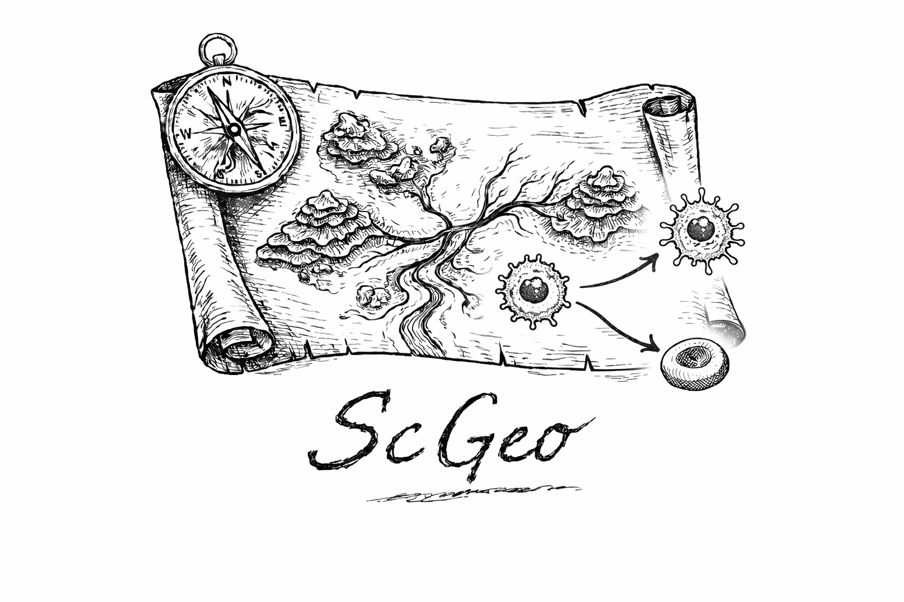
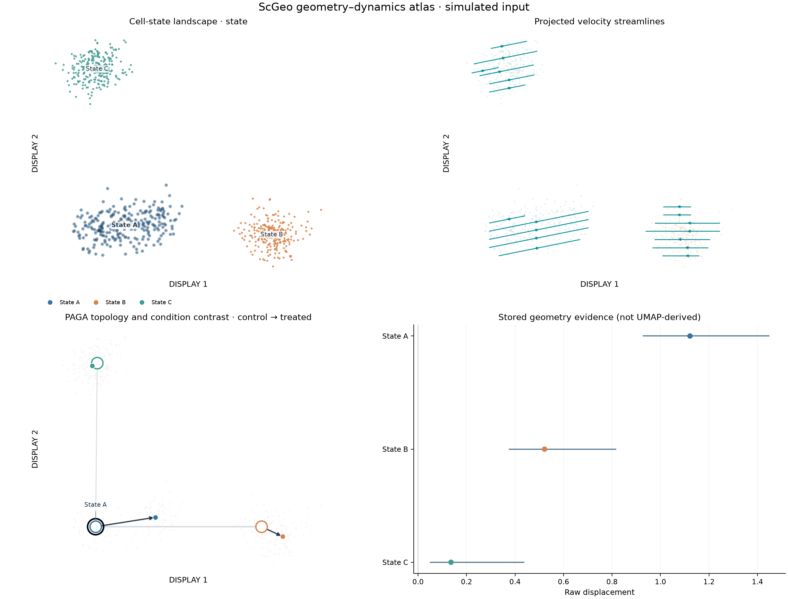
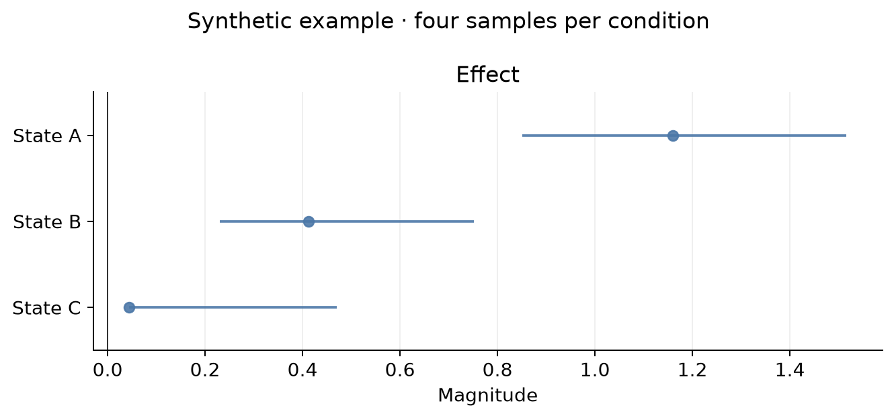
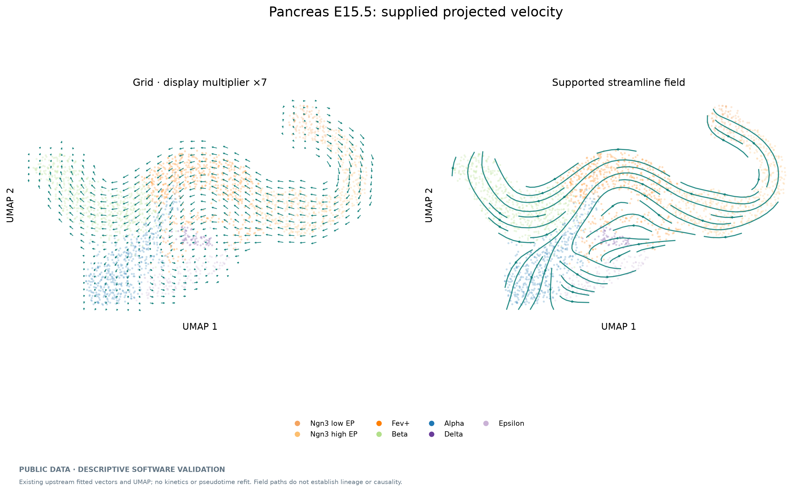

<p align="center">
  
</p>

<h1 align="center">ScGeo</h1>
<p align="center"><strong>Quantify cell-state shifts across conditions and representations.</strong></p>

[](https://pypi.org/project/scgeo/)
[](https://doi.org/10.1093/bioadv/vbag266)
[](https://github.com/liuifrec/scgeo/blob/main/docs/INSTALLATION.md)
[](https://github.com/liuifrec/scgeo/blob/main/LICENSE)

**[Quick start](https://github.com/liuifrec/scgeo/blob/main/docs/QUICKSTART.md) ·
[Installation](https://github.com/liuifrec/scgeo/blob/main/docs/INSTALLATION.md) ·
[API reference](https://github.com/liuifrec/scgeo/blob/main/docs/api_reference.md) ·
[Plotting gallery](https://github.com/liuifrec/scgeo/blob/main/docs/PLOTTING_GALLERY.md) ·
[Paper workflows](https://github.com/liuifrec/scgeo-notebooks) ·
[Cite ScGeo](https://github.com/liuifrec/scgeo/blob/main/docs/CITING.md)**

ScGeo turns existing single-cell representations into quantitative comparisons
of cell states. Estimate displacement between conditions, quantify uncertainty
across biological samples, examine agreement across prespecified representations,
and compare geometric shifts with supplied dynamics such as RNA velocity.

The Python library works with **AnnData** and the **Scanpy** ecosystem. Its
outputs are inspectable state-level tables and figures, with separate evidence
for displacement, representation stability, local geometry, and dynamics.

**Published in Bioinformatics Advances:**
[Liu and Yoshida (2026), vbag266](https://doi.org/10.1093/bioadv/vbag266).

**New in the development checkout:** One command composes available cell-state,
projected-velocity, PAGA, and stored evidence views, without rerunning an
analysis:

```python
import scgeo as sg

result = sg.pl.geometry_dynamics_atlas(adata, color="cell_type", panels="auto", show=False)
result.save("geometry_dynamics", formats=("pdf", "svg", "png"))
```

[See the reproducible atlas gallery and input requirements](https://github.com/liuifrec/scgeo/blob/main/docs/GEOMETRY_DYNAMICS_ATLAS.md).



*Synthetic demonstration only: constructed display coordinates, projected vectors and topology; quantitative effects computed on the simulated representation. [Reproduce the figure](https://github.com/liuifrec/scgeo/blob/main/examples/geometry_dynamics_atlas_gallery.py).*

**Flexible UMAP and projected-velocity comparisons** are also available in
the development checkout, without prescribing an experimental organism or
design:

```python
import scgeo as sg

result = sg.pl.embedding_facets(
    adata, facet="condition", color="cell_type", velocity="stream",
    return_result=True, show=False,
)
result.save("faceted_velocity", formats=("png", "svg", "pdf"))
```

[Facet plotting guide](https://github.com/liuifrec/scgeo/blob/main/docs/EMBEDDING_FACETS.md) ·
[Reproducible faceting gallery](https://github.com/liuifrec/scgeo/blob/main/examples/embedding_facets_gallery.py)

## Start here

| Your goal | Best starting point |
| --- | --- |
| Analyze your own AnnData object | [Quick start](https://github.com/liuifrec/scgeo/blob/main/docs/QUICKSTART.md) |
| Try ScGeo without downloading a dataset | [Runnable synthetic example](https://github.com/liuifrec/scgeo/blob/main/examples/quickstart.py) |
| Build evidence figures and compare contrasts | [Development plotting guide](https://github.com/liuifrec/scgeo/blob/main/docs/PLOTTING.md) and [visual gallery](https://github.com/liuifrec/scgeo/blob/main/docs/PLOTTING_GALLERY.md) |
| Display state connectivity, condition shifts, and velocity | [PAGA shift-map guide](https://github.com/liuifrec/scgeo/blob/main/docs/PAGA_SHIFT_MAP.md) |
| Compare conditions, timepoints, batches or cell types in matched UMAP/velocity facets | [Embedding faceting](https://github.com/liuifrec/scgeo/blob/main/docs/EMBEDDING_FACETS.md) |
| Inspect local projected velocity and compare conditions | [Local velocity fields](https://github.com/liuifrec/scgeo/blob/main/docs/VELOCITY_FIELDS.md) |
| Compose UMAP, velocity, PAGA and evidence in one figure | [Unified geometry–dynamics atlas](https://github.com/liuifrec/scgeo/blob/main/docs/GEOMETRY_DYNAMICS_ATLAS.md) |
| Interpret stored geometry–velocity agreement and compare condition fields | [Geometry–velocity interpretation](https://github.com/liuifrec/scgeo/blob/main/docs/GEOMETRY_VELOCITY_INTERPRETATION.md) |
| Compare annotations with ribbons, chords, and density panels | [State associations and density](https://github.com/liuifrec/scgeo/blob/main/docs/STATE_FLOW_AND_DENSITY.md) |
| Run plotting checks on public single-cell datasets | [Real-data plotting gallery](https://github.com/liuifrec/scgeo/blob/main/docs/REAL_DATA_PLOTTING.md) |
| Understand the framework and outputs | [Overview](https://github.com/liuifrec/scgeo/blob/main/docs/OVERVIEW.md) and [analysis layers](https://github.com/liuifrec/scgeo/blob/main/docs/ANALYSIS_LAYERS.md) |
| Explore the paper's datasets and figures | [Companion workflows](https://github.com/liuifrec/scgeo-notebooks/blob/main/docs/START_HERE.md) |
| Reproduce the published analyses | [Frozen provenance](https://github.com/liuifrec/scgeo/blob/main/docs/REPRODUCIBILITY.md) |
| Cite the method or report your analysis | [Citation and Methods guide](https://github.com/liuifrec/scgeo/blob/main/docs/CITING.md) |

## Install

For a standard Scanpy workflow, start in a fresh Python 3.12 environment:

```bash
python -m pip install "scgeo[scanpy]==0.1.0"
python -m pip check
```

For core geometry and plotting, use `python -m pip install scgeo==0.1.0`.
Optional `notebook`, `scvelo`, and `census` extras support additional workflows.
The [installation guide](https://github.com/liuifrec/scgeo/blob/main/docs/INSTALLATION.md)
explains feature dependencies, Windows/macOS/Linux use, and development installs.

Prefer conda? Create the environment with conda and install the released package
with pip:

```bash
conda create -n scgeo -c conda-forge python=3.12 pip
conda activate scgeo
python -m pip install "scgeo[scanpy]==0.1.0"
```

**Native Bioconda publication is pending** as of 17 November 2026;
[follow PR #70318](https://github.com/bioconda/bioconda-recipes/pull/70318).
The command above is the supported conda-managed route to the PyPI release.

## A first analysis

For an existing `adata`, this example expects `condition`, `cell_type`, and
`sample` in `adata.obs`, plus quantitative coordinates in `adata.obsm["X_pca"]`.
Here `sample` identifies independent biological samples, and `condition` contains
`control` and `treated`. Replace these keys and labels with your own.

```python
import scgeo as sg

sg.tl.robust_shift(
    adata,
    rep="X_pca",
    condition_key="condition",
    group0="control",
    group1="treated",
    by="cell_type",
    sample_key="sample",
    n_boot=500,
)

report = sg.get.state_report(adata, node_key="cell_type")
sg.pl.state_evidence_panel(report)
```

This first step estimates displacement and sample-level uncertainty in one
representation. Add representation stability, local geometry, and dynamics
when their inputs are available; the report keeps missing evidence visible.
The [full quick start](https://github.com/liuifrec/scgeo/blob/main/docs/QUICKSTART.md)
includes synthetic input, expected output, and the next analysis steps.

### Example output



*Actual output from the [synthetic example](https://github.com/liuifrec/scgeo/blob/main/examples/quickstart.py):
720 simulated cells, three states, four samples per condition, and one supplied
representation. This illustrates the API, not a biological result. Bootstrap
magnitude intervals summarize resampling uncertainty and are not significance tests.*

## Development plotting preview

The current source checkout adds clearer PAGA shift maps with distinct condition
centres, local projected-velocity grids and streamlines, and stored alignment
colours. It also adds proportional chord diagrams, polished alluvial ribbons,
and density panels with explicit common or relative scales, alongside evidence
panels, biological-sample views, scoped styles, and source-data exports.
These additions are **unreleased**; they are
not part of the published `scgeo==0.1.0` distribution. Use the
[plotting guide](https://github.com/liuifrec/scgeo/blob/main/docs/PLOTTING.md)
to install the matching checkout and reproduce the gallery.



*Generated by the [public-data example](https://github.com/liuifrec/scgeo/blob/main/examples/real_data_plotting_gallery.py)
from CellRank's preprocessed pancreas E15.5 input. ScGeo reuses the supplied
UMAP and fitted projected velocities; it does not refit kinetics or establish
lineage. The [real-data guide](https://github.com/liuifrec/scgeo/blob/main/docs/REAL_DATA_PLOTTING.md)
also demonstrates PBMC annotation chords, alluvial ribbons, and matched density
panels with exact input hashes and source tables. The
[full gallery](https://github.com/liuifrec/scgeo/blob/main/docs/PLOTTING_GALLERY.md)
retains the controlled synthetic examples for PAGA contrasts, biological-sample
views, and known support failures.*

## Questions ScGeo can help answer

| Question | Main function | Output to inspect |
| --- | --- | --- |
| Which states moved between conditions? | `tl.robust_shift` | displacement, normalized effect, sample-bootstrap uncertainty |
| Does the conclusion persist across representations? | `tl.representation_stability` | agreement, coverage, leave-one-representation-out sensitivity |
| How much did local neighborhoods change? | `tl.local_geometry_stability` | overlap, Jaccard, local distortion |
| Do shifts agree with supplied RNA-velocity estimates? | `tl.velocity_shift_alignment` | alignment, discordance, unavailable evidence |
| Did composition or within-state distributions change? | `tl.paga_composition_stats`, `tl.distribution_test` | separate abundance and distribution summaries |
| How can these results be reviewed together? | `get.state_report`, `pl.state_evidence_panel` | one state-level report and separate evidence tracks |

See the [API reference](https://github.com/liuifrec/scgeo/blob/main/docs/api_reference.md)
for parameters, optional dependencies, and public utilities.

## Controlled benchmarks

The `scgeo.bench` module tests displacement, abundance, distributional shape,
local distortion, representation stability, uncertainty, and geometry–dynamics
agreement under known simulated perturbations. Calibration and held-out seeds
remain separate, with the protocol's frozen thresholds retained.

Two sample-design scenarios are particularly useful for interpreting results:
`balanced_replicate_heterogeneity` uses random sample offsets that are
zero-centered within each condition, testing uncertainty without a systematic
condition shift. `batch_condition_confounding` adds a systematic sample/batch
offset correlated with condition; that contrast is **non-identifiable** without
additional design information.

These simulations assess behavior under stated failure modes. They do not
establish biological truth. See the
[frozen benchmark protocol](https://github.com/liuifrec/scgeo/blob/main/docs/revision/BENCHMARK_PROTOCOL.md)
for scenarios, evaluation rules, and provenance.

## From the method to the paper

The study begins with **post-irradiation hematopoietic recovery (GSE280305)**.
Controlled simulations and public pancreas, inflammatory HSPC, and mouse-lung
radiation workflows examine complementary aspects of the framework.
The [companion repository](https://github.com/liuifrec/scgeo-notebooks)
provides dataset entry points, analysis scripts, output maps, and evidence records.

For new analyses, use the released package and record its version. For paper
reproduction, use the recorded environments and frozen package checkpoint
[`9a0ed16`](https://github.com/liuifrec/scgeo/tree/9a0ed16cbaa57f935f9c9bc87d1643a25b51012c).
See [Reproducibility](https://github.com/liuifrec/scgeo/blob/main/docs/REPRODUCIBILITY.md).

## Interpretation that follows the study design

ScGeo analyzes representations you supply. Prespecify the biological contrast,
sample unit, and quantitative representations; keep UMAP for display and treat
nested PCA views as related sensitivity analyses. Read displacement, abundance,
distributional change, and dynamics as distinct evidence. Analyses without valid
biological-sample identities remain descriptive.

The labels `stable_effect`, `stable_neutral`, `representation_unstable`, and
`insufficient_coverage` describe the stored evidence rules. Their interpretation
depends on the design and available layers. See
[Result interpretation](https://github.com/liuifrec/scgeo/blob/main/docs/RESULT_INTERPRETATION.md).

## Cite ScGeo

Liu Y-C, Yoshida K. **ScGeo reveals non-canonical trajectories beyond RNA
velocity in radiation-induced hematopoietic recovery.** *Bioinformatics Advances*.
2026;6(1):vbag266. [doi:10.1093/bioadv/vbag266](https://doi.org/10.1093/bioadv/vbag266).

**[BibTeX](https://github.com/liuifrec/scgeo/blob/main/CITATION.bib) ·
[RIS for reference managers](https://github.com/liuifrec/scgeo/blob/main/CITATION.ris) ·
[CITATION.cff](https://github.com/liuifrec/scgeo/blob/main/CITATION.cff) ·
[Methods reporting guide](https://github.com/liuifrec/scgeo/blob/main/docs/CITING.md)**

Please cite the paper when using ScGeo and record the exact package version or
commit, input provenance, and analysis settings. Cite the original datasets and
upstream methods used in your workflow as well. The article DOI identifies the
paper; no separate software-archive DOI is asserted here.

## Questions and contributions

Use [GitHub Issues](https://github.com/liuifrec/scgeo/issues) for reproducible
problems, documentation improvements, and feature suggestions. Include the
ScGeo/Python versions, a minimal example, and the relevant AnnData keys and
shapes. Small synthetic examples are especially useful for resolving problems.
ScGeo is distributed under the [MIT license](https://github.com/liuifrec/scgeo/blob/main/LICENSE).
