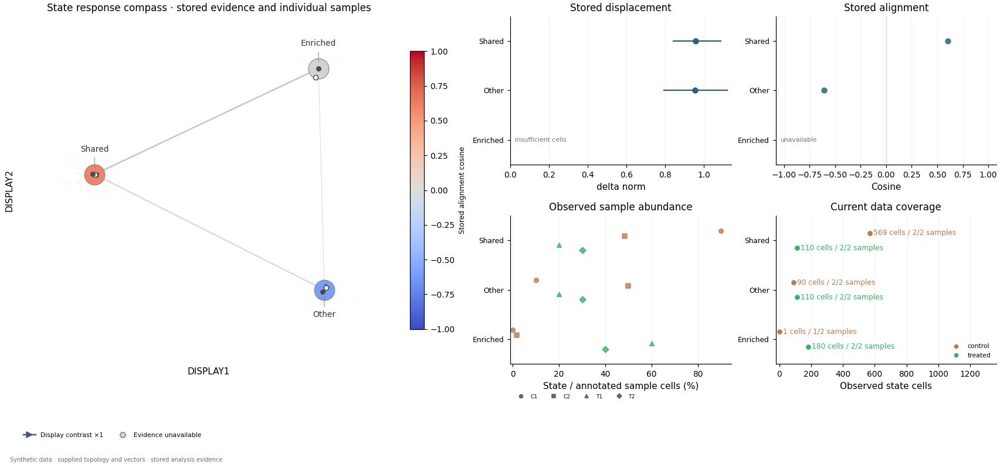

# State response compass and readable evidence plots

The compass can combine observed state locations with stored quantitative
evidence and individual biological samples. The numerical evidence remains
separate from the coordinates used to draw the map.

The plotting update adds a stored-evidence mode, pooled node anchors, an
optional summary layout, explicit coverage, and consistent rendering controls.
It also corrects several legacy input and missing-value behaviors. It does
not change the statistical estimators in `scgeo.tl`.



*Actual output from the executable synthetic gallery below. The graph,
display coordinates and vectors are constructed; these are not biological
observations.*

## A compass using stored evidence

First run the analysis appropriate for the experiment. This example assumes
stored sample-aware `robust_shift` and `representation_stability` results,
including compatible velocity evidence. It reads those results without
refitting them:

```python
import scgeo as sg

report = sg.get.state_report(adata, node_key="state")
source = adata.uns["scgeo"]["representation_stability"]
alignment = source["per_rep_state"].loc[
    source["per_rep_state"]["rep"].eq("X_pca")
].copy()
# Retain the analysis parameters when selecting a table from its stored bundle.
alignment.attrs["params"] = dict(source["params"])

result = sg.pl.recovery_compass(
    adata,
    node_key="state",
    condition_key="condition",
    group0="control",
    group1="treated",
    basis="umap",
    mode="stored",
    shift_df=report,
    alignment_df=alignment,
    analysis_rep="X_pca",
    effect_metric="delta_norm",
    node_position="pooled",
    sample_key="sample",
    layout="summary",
    ring_mode="none",
    return_result=True,
    show=False,
)
result.save("state_response_compass", formats=("png", "svg", "pdf"))
```

`mode="stored"` requires a shift table and an explicitly declared analysis
representation. Alignment may be unavailable: an assessed displacement does
not disappear merely because velocity evidence is missing. Source state
identifiers are joined by identity, never by table row order.

The validator compares recorded representation and ordered-contrast metadata
from columns and table attributes, including `attrs['params']` and
`attrs['provenance']`. Known conflicts raise before drawing. Caller declarations
can supply missing metadata, but such fields remain declared and unverified;
they do not acquire verified provenance from being passed to a plotting call.

The shift estimator and velocity aggregation are distinct pieces of provenance.
The current `representation_stability` analysis uses its specified displacement
estimator and averages supplied velocity vectors over the selected contrast
cells. Supplying a sample key does not turn that velocity mean into an
equal-sample velocity estimate. The plot preserves the stored quantity.

Changing only a display embedding must not change stored effect, alignment,
intervals, or source eligibility. Map arrows are descriptive connectors between
observed display centers. Their lengths are not analysis-space effect sizes.

## Source coverage, missing evidence, and sparse states

Pooled node positions use observed cells from the selected contrast. An
observed state can therefore remain in the graph when its reference condition
has zero or one captured cell. This does not supply a missing reference center
or make an unsupported comparison eligible.

The report's numerical estimate and its display eligibility are separate.
For example, a robust center contrast may be numerically computable from one
reference cell and be labeled `effect_status='assessed'` in a stored report.
Known source cell counts below the compass's `min_cells` threshold still mark
that comparison unsupported. The original estimate remains in the source
table. Current display-subset counts do not replace source analysis counts.

Known insufficient biological replication is explicitly descriptive. Its
uncertainty interval is withheld. Unknown replication is recorded as unknown,
not reconstructed from a sample name or a plotted point. An explicitly supplied
interval with unknown support can remain visible as a stored, unverified
interval, with a warning and summary-panel note. It does not acquire supported
biological inference from plotting. A combined report
coverage flag from another analysis module does not automatically suppress an
otherwise supported displacement; each numerical channel retains its own
availability and reason.

Raw and normalized effect sizes use their own matching interval columns.
Raw-magnitude intervals are never placed on normalized estimates. The plot
does not infer confidence intervals, angular uncertainty cones, or new tests.

### Sample frequencies and observed zeros

The sample abundance panel computes descriptive state frequencies from the
full supplied contrast roster. A state absent from an observed sample with a
positive annotated-cell denominator contributes frequency zero. A missing
denominator remains unavailable. Sample labels absent from the supplied
AnnData cannot be reconstructed.

Use a complete, biologically defined denominator population. Display budgets
and focus settings must not change its sample counts or frequencies. Individual
sample points remain visible; no pairing between independent animals is
inferred.

## Display mode and deliberate correctness changes

`mode="display"` retains the descriptive two-dimensional calculation path.
The default `velocity_scope="contrast"` now restricts velocity summaries to
the requested conditions. Use an explicit `velocity_scope="all"` to reproduce
the legacy all-input-condition scope. `"group0"` and `"group1"` allow separate
condition summaries.

Projected velocity must match the display basis. Complete finite vector rows
are counted jointly; separately averaging different incomplete coordinates
cannot create an observed usable vector. Zero displacements and zero-scale
arrows are not drawn as directions.

OOD encodings expose their threshold and condition scope. Use an explicit
`ood_threshold` when comparisons should share a calibrated or predeclared
threshold. A data-derived percentile is descriptive of its declared input
population. Score coverage and missing counts remain exported. A state with
no finite scores has unavailable OOD burden, never a measured fraction of zero.

## Consistent scales, labels, and figure composition

The map can use supplied fill and arrow normalization, a common node-size
reference, point-sized arrowheads, and labels placed outside nodes. Explicit
offsets remain useful for a final manuscript arrangement. Each numerical
encoding should retain the same scale across comparable panels.

The summary layout keeps topology, quantitative evidence, sample frequencies,
and coverage in distinct axes. Supplied axes support placement inside a larger
figure; the plotting call preserves the parent figure's size and layout.
Missing values use availability labels rather than a numeric color at zero.

The function name remains compatible. Interpret positive alignment as movement
along the declared reference-to-comparison displacement and negative alignment
as opposition to that displacement. Neither sign establishes recovery,
destination, timescale, or lineage.

## Consensus selection and prevalence

`consensus_structure` retains global top-k selection by default. An explicit
threshold is available for a common selection rule across figures:

```python
result = sg.pl.consensus_structure(
    adata,
    score_key="response_score",
    groupby="state",
    selection="threshold",
    threshold=1.0,
    sample_key="sample",
    max_points=4000,
    random_state=0,
    rasterized="auto",
    hi_alpha=0.9,
    outline_alpha=0.4,
    return_result=True,
    show=False,
)
```

The highlighted face and outline opacity are independent. The source tables
separate the share of selected cells belonging to a group from the fraction
of that group selected, with both all-cell and finite-score denominators.
Sample summaries preserve zero selections and score coverage. A supplied
score keeps the interpretation of the analysis that produced it; high score
selection does not create treatment effects or replicate agreement.

Display budgets preserve selected cells and their groups/sample strata. If
the requested budget cannot retain required observations, the function reports
why the budget is insufficient. Drawing fewer background points does not change
selection, denominators, or summary values.

## Concordance and atlas views

`geometry_velocity_concordance` validates stored evidence, keeps effect and
alignment availability separate, honors display names, and applies a
deterministic label budget. Explicit highlights take priority. Unavailable
states remain visible in the evidence view. Reusing the same axis for two
different panels is rejected.

`geometry_dynamics_atlas` accepts shared numeric color normalization and
offers an adaptive layout. State labels prioritize explicit highlights, which
may exceed the ordinary-label budget. Long legends record omissions explicitly. Optional sample-coverage
annotations remain available when composing on caller-supplied axes.

## Reproduce the synthetic examples

```bash
python examples/compass_evidence_gallery.py \
    --output-dir results/compass_upgrade --formats png svg pdf
```

The gallery uses generic synthetic samples, known display coordinates,
constructed velocity vectors, and a supplied symmetric graph. Stored shift
and representation results are generated by the actual ScGeo analysis APIs.
The second representation is an orthogonal rotation of the first; it tests
coordinate handling and does not count as independent biological validation.
An optional `--benchmark` records rendering/export timings on a larger
synthetic background with the same rasterization policy for both display
budgets. Timing values describe the executing environment and
are not a performance guarantee.

The [local validation record](validation/compass_evidence_20261125.json) records
the synthetic checks, exact plotting-source hashes, environment, observed
timings, full test-suite result, and installed-wheel verification.

See [sparse-state plotting](CONDITION_SPARSE_STATES.md),
[the plotting guide](PLOTTING.md), and
[the plotting API](api/pl.md).
