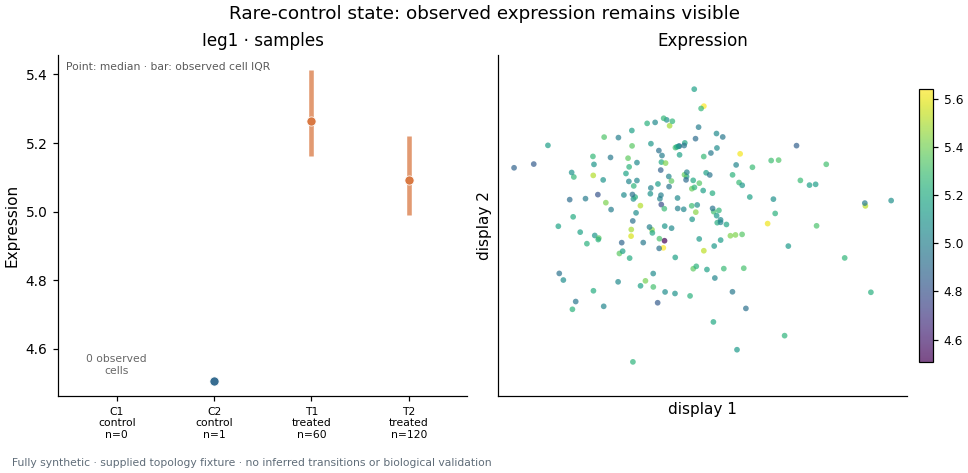
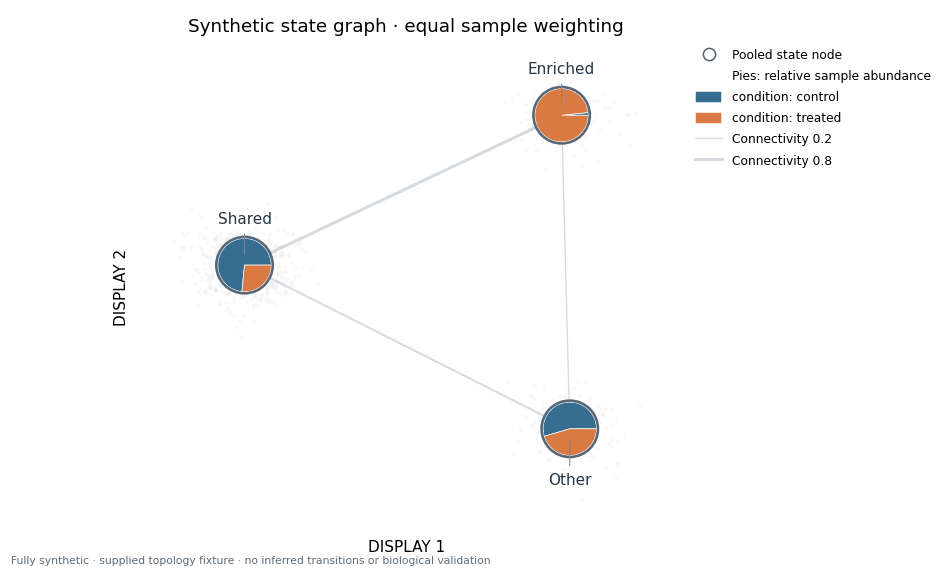

# Plot states with sparse condition coverage

A state can be strongly enriched in one condition while having too few cells
in the other condition to estimate a useful within-state response. Preserve
the observed expression, cell counts, and sample frequencies. Mark the
unsupported comparison explicitly.

The 0.2.0 plotting extensions keep these outputs separate:

| Available information | Useful display |
|---|---|
| Observed expression, including a single reference cell | Expression map and per-sample expression summary with cell counts |
| State missing from a sample whose denominator was observed | Zero state count/frequency and a blank expression slot |
| No supported shift direction | Unavailable curve/contribution panel; explicit genes/programs required |
| A documented common numeric coordinate | Descriptive sample curves using `coordinate_key`, restricted to observed support |
| State present almost entirely in one condition | Pooled PAGA node and composition pie, with separate sample evidence |

These APIs are included in the 0.2.0 release source; see [Installation](INSTALLATION.md) for the verified index release or a pinned source installation.
They do not change the stored `robust_shift` or `explain_shift` estimators.

## Show expression without requiring a shift axis

Use the complete AnnData object containing both conditions and the observed
sample roster. The existing `explain_shift` result can retain a state with
`status='insufficient_cells'` or `zero_shift`.

```python
import scgeo as sg

result = sg.pl.shift_curves(
    adata,
    state="Enriched",
    var_names=["Ieg1"],  # replace with a gene in your data
    panels=("distribution", "expression"),
    basis="umap",
    return_result=True,
    show=False,
)
result.save("enriched_state_expression", formats=("png", "svg", "pdf"))
```

The distribution panel shows empirical sample medians and interquartile
ranges, with observed cell counts. These are expression summaries, not
confidence intervals or the robust centers used for displacement attribution.
A singleton is an observed expression point. A sample with no cells in the
state has missing expression; it is never plotted as an expression value of
zero. Without a biological sample key, the display is labelled as pooled cells.

An expression-only or distribution-only call does not require a shift
coordinate. A distribution-only call also does not require an embedding.
If a requested curve or contribution panel lacks the required evidence, the
panel displays an availability message. When the contribution ranking is
undefined, supply `var_names` or `program_names` explicitly.

The result exports cell-level values, per-sample expression summaries,
coverage, and panel availability. Counts and summaries use all selected
observations even when `max_points` reduces displayed scatter points.



This synthetic example has zero cells in one control sample and one in the
other. The empty sample slot and singleton remain visible alongside the two
treated samples; there is no estimated control curve.

### An explicitly supplied coordinate

If a shared biological coordinate has already been defined, it can be used
for descriptive expression curves:

```python
result = sg.pl.shift_curves(
    adata,
    state="Enriched",
    var_names=["Ieg1"],
    coordinate_key="baseline_score",  # existing documented numeric obs column
    panels=("curve", "distribution", "expression"),
    basis="umap",
    return_result=True,
    show=False,
)
```

The supplied coordinate does not alter the stored shift, its gene ranking,
or its contribution coefficients. Curves retain the existing sample-wise
support rules: no extrapolation and no ribbon supported by only one sample.
A few reference cells can therefore appear as observed points without a
reference curve. The coordinate's biological interpretation comes from the
analysis that produced it; this argument does not infer time or a trajectory.

## PAGA pies that retain condition-enriched states

`paga_shift_map` already supports pies through `pie_key`. Its default
`node_position="reference"` uses reference-condition anchors, matching the
legacy displacement display. For a composition view, use pooled anchors:

```python
result = sg.pl.paga_shift_map(
    adata,
    node_key="state",
    condition_key="condition",
    group0="control",
    group1="treated",
    basis="umap",
    graph_node_order=graph_order,  # order recorded for the supplied PAGA graph
    node_position="pooled",
    pie_key="sample",
    pie_mode="cell_fraction",
    node_color_mode="constant",
    constant_node_color="0.25",
    show_shift=False,
    show_endpoints=False,
    show_velocity=False,
    background="contrast",
    return_result=True,
    show=False,
)
result.save("paga_sample_pies", formats=("png", "svg", "pdf"))
```

This uses observed cells from the two selected conditions to position nodes.
An observed node and its supplied graph connections can remain visible when
its reference-state count is zero. Node positions and sizes are exported;
the underlying graph is not refitted. Node size remains a captured-cell count
encoding, not biological sample size or an abundance effect estimate.

When shift arrows are requested, they still connect actual condition centers
and require support in both conditions. Pooled node positions never replace
their origins. PAGA connectivity is not evidence that one condition's cells
became another state.

### Choose what the sectors mean

| Settings | Meaning of a sector |
|---|---|
| `pie_key="condition", pie_mode="cell_fraction"` | Fraction of the state's captured cells from each condition |
| `pie_key="sample", pie_mode="cell_fraction"` | Fraction of the state's captured cells from each biological sample |
| `pie_key="condition", pie_mode="sample_abundance", pie_sample_key="sample"` | Relative mean state frequency after giving each observed sample equal weight within its condition |

Raw cell fractions can be dominated by a deeply sampled library. To obtain
the third view, first compute each sample's state frequency:

\[
p_{sk}=n_{sk}/N_s.
\]

Here, `N_s` counts the eligible annotated cells in the supplied AnnData for
that sample and selected condition. The function averages valid sample
frequencies within each condition, then normalizes the condition means to
sum to one for the pie. It exports the underlying means as well as the
plotted sector fractions. This normalized abundance profile is a different
quantity from captured-cell composition.

For the sample-normalized view, set `pie_key="condition"`,
`pie_mode="sample_abundance"`, and `pie_sample_key="sample"` in the call
above. This mode requires `pie_key` to equal `condition_key`.

An observed sample with a positive denominator and no cells in a particular
state contributes frequency zero. A zero denominator is undefined and is
retained as missing evidence. No pseudocount is added. A sample absent from
the entire AnnData object cannot be reconstructed from that object.

Call the function on the full denominator population. Use `focus_states`
for display emphasis; subsetting AnnData to the enriched state first would
discard the intended abundance denominator and potentially remove samples.
The exported sample counts and denominators make the scope inspectable.



All three observed synthetic states remain in the supplied graph. In this
example, multiplying one sample's captured cells fivefold changes raw pie
fractions by up to 0.2904 but leaves all sample-abundance fractions unchanged.
This check concerns sampling depth; the underlying frequencies and sample
roster remain fixed.

## A separate broader-parent analysis

Two related states may be examined as a broader population when their shared
identity is biologically justified. Preserve the original state labels and
create a new annotation for the parent:

```python
import pandas as pd

original = adata.obs["state"].astype(str)
parent = original.where(~original.isin(["Shared", "Enriched"]), "Parent")
adata.obs["parent_state"] = pd.Categorical(parent)

sg.tl.robust_shift(
    adata,
    rep="X_pca",
    condition_key="condition",
    group0="control",
    group1="treated",
    by="parent_state",
    sample_key="sample",
    center="geometric_median",
    store_key="parent_shift",
)
parent_result = sg.tl.explain_shift(
    adata,
    shift_key="parent_shift",
    states=["Parent"],
    local_key="state",
    store_key="parent_explanation",
)
sg.pl.shift_curves(
    adata,
    key="parent_explanation",
    state="Parent",
    var_names=["Ieg1"],
    color="state",
    basis="umap",
)
```

This asks about the broader population. Its displacement can reflect a
change in the mixture of its original states as well as expression changes
within them. Retain the supported shared-state comparison and inspect the
parent result's local contrasts and sample composition together. Choosing a
parent after observing condition enrichment makes that analysis exploratory.
The broader population does not supply missing reference cells for the
enriched state, and connectivity alone does not establish a precursor identity.

With two biological samples per condition, retain all four sample effects
and counts. There are only six possible 2-versus-2 label assignments;
additional cells or repeated permutations do not create more independent
biological replication.

## Reproduce the synthetic examples

```bash
python examples/condition_sparse_states_gallery.py \
    --output-dir results/condition_sparse_states --formats png svg pdf
```

The example uses generic synthetic samples, an affine expression representation,
and a declared symmetric graph fixture. It tests absent/singleton reference
coverage and the difference between captured-cell and equal-sample pie values.
It contains no biological dataset or private sample information.
The [validation record](validation/condition_sparse_states_20261125.json)
contains the twelve checked invariants and the displayed example values.

See also [shift explanations](EXPLAIN_SHIFT.md), [PAGA display semantics](PAGA_SHIFT_MAP.md),
and the official [Scanpy PAGA plotting API](https://scanpy.readthedocs.io/en/stable/api/generated/scanpy.pl.paga.html)
and [scVelo PAGA plotting API](https://scvelo.readthedocs.io/en/stable/scvelo.pl.paga.html).
