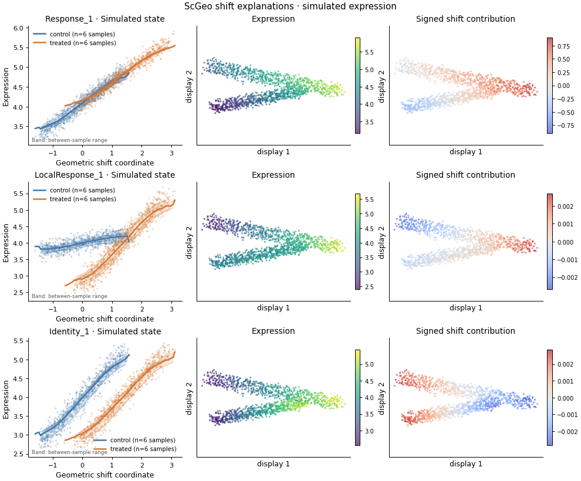
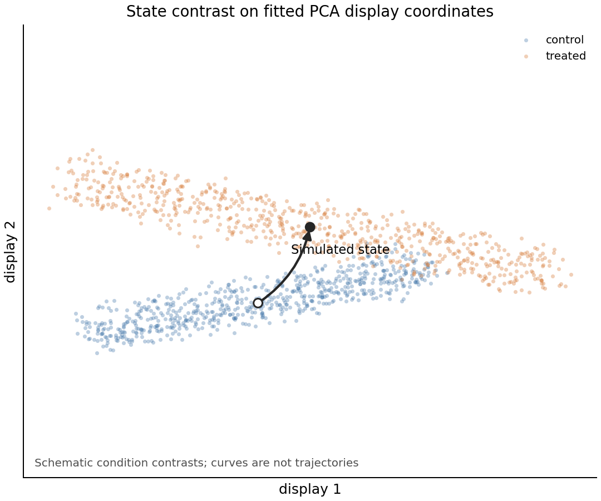

# Explain a measured state displacement

`scgeo.tl.explain_shift()` connects a stored ScGeo displacement to genes and
gene programs in the expression matrix that generated its representation.
It reports signed feature contributions, biological-sample evidence, and
optional local comparisons. `scgeo.pl.shift_curves()` and
`scgeo.pl.shift_embedding()` turn these results into inspectable figures.

This is an **observational explanation of a specified geometric effect**.
A large contribution identifies a feature that accounts for the measured
direction under the supplied representation. It does not establish that
perturbing that gene would cause or reverse the state change.

[Analysis layers](ANALYSIS_LAYERS.md) ·
[State evidence](RESULT_INTERPRETATION.md) ·
[Projected velocity fields](VELOCITY_FIELDS.md) ·
[Executable synthetic gallery](../examples/explain_shift_gallery.py) ·
[Citing ScGeo](CITING.md)

> **Development API:** These functions are available in the development
> checkout containing this guide. Install that checkout with
> `python -m pip install -e .` or pin a reviewed commit. The example uses
> simulated inputs; it does not reproduce a biological study.

## Rendered synthetic example



*Fully synthetic input with six simulated samples per condition. Each row
shows one example gene: expression along the geometric shift coordinate,
expression on the display embedding, and signed pointwise contribution on
that embedding. Thin curves summarize individual samples; shaded bands
show between-sample ranges. The analysis uses eight fitted PCs, while the
display shows the first two. These figures demonstrate the calculation and
its presentation; they provide no biological driver validation.*



*The same simulated state displayed on its first two PCs. The endpoints
use the stored reference and comparison center weights. The curved arrow
is a schematic connector indicating the condition contrast, not an
inferred cell trajectory or RNA-velocity field.*

Both images are generated by the
[executable gallery](../examples/explain_shift_gallery.py). The
[recorded synthetic validation summary](validation/explain_shift_20261124.json)
contains the numerical checks and provenance. Full source tables and
vector-format figures are reproduced by running the gallery below.
The gene-panel image in this guide uses reduced raster resolution; the
gallery exports the full-resolution PNG alongside SVG and PDF versions.

## What changes compared with expression marker screening

An expression contrast and a displacement explanation answer different
questions. A conventional differential-expression analysis can test whether
expression differs between conditions while accounting for biological
samples. `explain_shift()` asks how features contribute to one **already
defined displacement** in a documented representation.

| Output | Question it addresses | Interpretation limit |
|---|---|---|
| Gene contribution | How does this feature contribute along the observed shift direction? | Conditional on the expression transform, representation, center estimator, and selected state |
| Program contribution | How much signed contribution is carried by a supplied set of genes? | Overlapping programs do not partition the effect |
| Sample evidence | Is the observed pattern consistent across the available biological samples? | Cell count does not replace sample replication |
| Local comparison | Does expression change differ across supplied baseline neighborhoods or categories? | Categories and common support determine what can be compared |
| Composition summary | Did the frequencies of the supplied local categories change? | An abundance change can contribute to a broad state's displacement |
| Signed target evidence | Are a regulator's supplied target directions consistent with the observed expression response? | Prior-informed candidate evidence, not a fitted regulatory mechanism |

The existing `alignment_driver_genes()` remains a marker-screening helper
for supplied alignment labels. A displacement explanation uses the stored
shift vector directly and does not require aligned/discordant labels or
RNA velocity.

## Quick start with a documented PCA representation

Use the expression matrix and feature order from which the representation
was constructed. Here `adata.X` contains normalized, transformed expression,
`adata.obsm['X_pca']` holds the retained PCs, and `adata.varm['PCs']` contains
the corresponding feature loadings.

```python
import scgeo as sg

sg.tl.robust_shift(
    adata,
    rep='X_pca',
    condition_key='condition',
    group0='control',
    group1='treated',
    by='cell_type',
    sample_key='sample_id',
    center='geometric_median',
    n_boot=200,
    seed=37,
    store_key='robust_shift',
)

explanation = sg.tl.explain_shift(
    adata,
    shift_key='robust_shift',
    loadings_key='PCs',
    states=['HSPC'],
    modules={
        'Example program': ['GENE_A', 'GENE_B', 'GENE_C'],
    },
    min_cells=10,
    min_samples=2,
    n_boot=200,
    seed=37,
    store_key='explain_shift',
)

print(explanation['summary'])
print(explanation['genes'])
print(explanation['programs'])
```

Replace the illustrative state and gene names with your annotations.
`group1 - group0` defines the direction. Keep that orientation explicit when
comparing analyses or interpreting signed contributions.

The source `robust_shift()` calculation must use `center='mean'` or
`center='geometric_median'`. Coordinate-wise medians and trimmed means do not
in general share a single set of cell weights across representation
dimensions, so they are not silently substituted into the affine accounting.

The returned `source_params` contains a separate snapshot of the source
`robust_shift()` parameters. Keep it with the explanation's own `params`
when recording the analysis configuration.

### Expression layers, scaling, and mapping checks

Use `layer='log_expression'` when the representation was built from that
layer rather than `adata.X`. Supply `loadings=...` for an explicit matrix
with rows in `adata.var_names` order. `feature_scale=...` accounts for
feature scaling in the affine map; it does not modify the expression values
in AnnData.

The returned `mapping['loadings_source']` records whether the actual
loadings came from an explicit matrix (`'explicit'`) or a named
`adata.varm[...]` entry. Use this field to track the loading source when
an explicit matrix overrides `loadings_key`.

The implementation checks whether the supplied expression and effective
loadings reproduce the stored representation up to one common intercept.
The default tolerances are `mapping_rtol=1e-5` and `mapping_atol=1e-6`.
These tolerances describe numerical agreement, not biological validity.
Use the actual normalization, scaling, feature selection, and loadings
from the representation's provenance. A different matrix is not made
compatible simply by giving it the same number of columns.

The calculation preserves the representation precision used by the source
`robust_shift()` implementation, including its float32 coordinate
conversion. The affine residual and center reconstruction error are
reported. Agreement is assessed within numerical tolerance, not assumed
to be exact bitwise equality. Large coordinate offsets that destroy
variation at that precision can therefore make a mapping incompatible.

An arbitrary UMAP, diffusion map, integrated latent representation, or
nonlinear decoder generally does not have this affine mapping. UMAP can
still serve as a **display** for contributions computed in a verified
expression-linked space. Distances and curved arrows drawn on that display
are not substituted for the effect measured in the analysis space.

## The signed accounting

For a fixed affine map,

\[
Z=XL+b,
\]

\(L\) includes any supplied feature scaling, and \(b\) is a common
intercept. Let the measured displacement be \(\Delta\) and its unit direction be
\(u=\Delta/\|\Delta\|\). The source estimator defines weights within
each biological sample and across samples. Applying the same weights to
the expression matrix gives matched expression centers
\(\tilde\mu_0\) and \(\tilde\mu_1\).

For gene \(g\), the contribution is

\[
C_g=(\tilde\mu_{1g}-\tilde\mu_{0g})(Lu)_g.
\]

With a verified affine mapping and matching estimator weights,

\[
\sum_g C_g=\|\Delta\|,
\]

up to recorded numerical tolerances. This identity concerns the **raw**
displacement in the retained representation. It does not say that the
selected genes account for the same fraction of all transcriptomic
variation or for a biological intervention effect.

- A positive contribution supports the selected direction.
- A negative contribution opposes that direction.
- A feature can have a large expression contrast and a small contribution
  if its loading is nearly perpendicular to the displacement.
- Correlated features can share the same descriptive signal. Their
  contributions are not independently identified causal effects.

Geometric-median weights must be those used by the actual finite-tolerance
center calculation. Computing separate gene-wise medians or inserting an
ordinary pseudobulk contrast into this formula would explain a different
estimator. The stored reconstruction diagnostics make this check visible.

For a zero displacement, there is no defined unit direction. Such a state
is reported as `zero_shift`; it does not acquire an arbitrary ranked axis.
Zero displacement does not imply equal distributions.

## Local patterns and composition

Use `local_key` for scientifically justified baseline neighborhoods or
categories that were defined before interpreting the condition response:

```python
explanation = sg.tl.explain_shift(
    adata,
    shift_key='robust_shift',
    states=['HSPC'],
    local_key='baseline_substate',
    modules={'Example program': ['GENE_A', 'GENE_B', 'GENE_C']},
    min_cells=10,
    min_samples=2,
    n_boot=200,
    seed=37,
)

print(explanation['local_summary'])
print(explanation['local_genes'])
print(explanation['composition'])
```

A broad state can contain an early neighborhood whose response is positive
and a late neighborhood whose response is negative. A whole-state average
can hide that structure. Conversely, a change in the mixture of otherwise
unchanged substates can move a broad-state center. Inspect the local
expression contrasts together with local-category frequencies before
describing the shift as a common cell-intrinsic response.

Each local group has its own displacement direction and corresponding
gene contributions. A feature can therefore have a positive contribution
to both an early positive shift and a late negative shift. Inspect
`expression_delta` to compare expression signs, and
`parent_axis_contribution` or `projection_on_parent_axis` to compare local
effects along the whole-state direction. Parent-axis quantities are
undefined when the whole-state displacement is zero.

`local_key` is a supplied grouping. The function does not infer matched
cell trajectories, estimate the identity of individual cells before and
after treatment, or prove that a comparison is free from confounding.
Condition-derived labels can encode the very effect being explained;
independent baseline annotation or an external reference is preferable
when available. Local groups lacking comparison support must retain their
coverage status rather than being extrapolated across missing conditions.

## Gene curves and embedding panels

The curve view uses each cell's projection onto the measured state-shift
axis. It is a geometric coordinate in the chosen representation. It is
not elapsed time, inferred developmental pseudotime, or a predicted cell
trajectory.

```python
curves = sg.pl.shift_curves(
    adata,
    var_names=['GENE_A', 'GENE_B'],
    state='HSPC',
    basis='umap',
    panels=('curve', 'expression', 'contribution'),
    return_result=True,
    show=False,
)
curves.save('figures/shift_gene_curves', formats=('png', 'svg', 'pdf'))

program_curves = sg.pl.shift_curves(
    adata,
    program_names=['Example program'],
    state='HSPC',
    basis='umap',
    panels=('curve',),
    return_result=True,
    show=False,
)
program_curves.save('figures/shift_program_curves', formats=('png', 'svg', 'pdf'))

embedding = sg.pl.shift_embedding(
    adata,
    states=['HSPC'],
    basis='umap',
    color='condition',
    return_result=True,
    show=False,
)
embedding.save('figures/state_shift', formats=('png', 'svg', 'pdf'))
```

The expression curves use sample-wise local smoothing without extrapolation
beyond a sample's support. The condition curve gives equal weight to the
samples supporting each position. The default ribbon, where supported,
is the between-sample range. It is **not a confidence interval** and is
separate from the contribution bootstrap. Inspect individual sample lines
and the exported sample-support tables when coverage is uneven.

These curves describe expression together with a coordinate that already
contains information about the condition response. A difference between
condition curves at the same shift coordinate is not a matched treatment
effect. A uniformly responsive program can have overlapping curves while
its cell distribution moves along the coordinate. An unchanged baseline
identity program can have separated curves because the response changes
that coordinate. Use the contribution accounting and independently
justified local comparisons to interpret these patterns.

Curved connectors in `shift_embedding()` show the orientation of a supplied
state contrast. They are schematic curves joining displayed reference and
comparison centers. They are not flow lines, velocity vectors, a fitted
vector field, or evidence that cells traveled along the drawn arc. For
independently supplied projected RNA velocity, use
[`scgeo.pl.velocity_field()`](VELOCITY_FIELDS.md).

The plotting functions return the usual ScGeo `PlotResult` when
`return_result=True`. Its source tables and metadata accompany exported
PNG, SVG, and PDF figures. `max_points` controls displayed points, not
the observations used to compute the explanation or sample curves.

## Biological samples and uncertainty

`sample_key` is inherited from the source `robust_shift()` result. When
biological samples are available, cells contribute to their sample centers;
cells are not relabeled as independent experimental replicates. Repeating
all cells of a sample uniformly must not give that sample extra weight in
the condition effect.

Without `sample_key`, the output is descriptive and there is no biological
sample bootstrap. When the same sample IDs appear in both conditions,
set `paired=True` and provide the same set of sample IDs in both groups.
This design requirement prevents an accidental independent-sample
interpretation of paired measurements. Identical paired sample sets are
required in each selected parent state and local group; incomplete pairs
are not silently dropped.

Contribution intervals and sign stability describe uncertainty under the
implemented sample resampling procedure. The observed representation and
shift direction are frozen; sample-center weights are re-estimated within
each bootstrap draw. These are conditional contribution intervals, not
uncertainty intervals for a refitted representation or a new shift axis.
They do not include every source
of uncertainty in preprocessing, annotation, representation learning, or
the choice of a state to investigate. With only two samples per condition,
resampling does not create more independent evidence. Use effect sizes,
individual sample patterns, and representation sensitivity, and keep any
inferential claims proportionate to the design.

`min_cells` and `min_samples` are coverage checks. Passing them does not
establish statistical power. `insufficient_cells` and
`insufficient_samples` remain explicit output states. A large number of
cells in one sample cannot compensate for inadequate biological replication.

`status='ok'` records calculability and coverage. It does not mean the
effect is significant or stable across representations. The separate
`representation_status` records evidence carried from a compatible stored
`representation_stability()` result when `representation_key` is supplied;
otherwise it remains `not_assessed`. Supplying that key does not refit or
independently validate the stored representation comparison.

That representation evidence belongs to the parent state. In
`local_summary`, `representation_status` remains `'not_assessed'`, while
`parent_representation_status` records the copied parent-state label.
A parent state that is stable across representations does not establish
the same property for each local group. Assess local representation
stability separately before making a local robustness claim.

## Optional regulator target evidence

Supply signed targets and an identifiable source when you have a curated
regulatory prior:

```python
explanation = sg.tl.explain_shift(
    adata,
    shift_key='robust_shift',
    states=['HSPC'],
    regulons={
        'TF_EXAMPLE': {'TARGET_ACTIVATED': 1.0, 'TARGET_REPRESSED': -1.0},
    },
    regulator_source='Example curated resource, exact release and filtering rule',
    seed=37,
)
print(explanation['regulators'])
```

The regulator's own transcript need not be the feature carrying the target
response. Signed target evidence adds a transparent prior-based view of
the observed expression changes. It is not a fitted gene regulatory
network, a knockout simulation, or a causal test. Record the resource
version, species mapping, filtering, and target coverage.

Using a gene to construct a representation and then finding it associated
with that representation is descriptive reuse of the same information.
It is not an independent association test. Holding out donors assesses
generalization across donors but does not by itself remove this
self-reference when held-out expression still defines the coordinate.
Feature/module exclusion, independent reference mapping, external
modalities, temporal information, and intervention experiments answer
different validation questions; none is silently inferred by this API.

## Reproduce the synthetic gallery

```bash
python -m pip install -e .
python examples/explain_shift_gallery.py \
  --output-dir results/explain_shift
```

The gallery generates continuous expression values for six simulated
samples per condition with unequal cell counts. A uniform-response program
and an opposing local-response program are planted alongside baseline
identity, sample variation, and unperturbed noise. It fits PCA once,
supplies its verified loadings, and exports figures, source tables,
input provenance, known simulation effects, and a benchmark summary.

The known simulation coordinate is provided as truth for this example.
The plotted two-dimensional embedding contains the first two fitted PCs;
it is not UMAP. The example contains no fitted RNA kinetics or biological
validation.

The gallery also records a distributional counterexample: control cells
at `(0, 0)` and `(2, 2)` and treated cells at `(0, 2)` and `(2, 0)` have
identical per-gene marginals and identical centroids, but different joint
distributions. A centroid-displacement explanation has no direction in
this case. Distributional and gene-dependence analysis remain separate
questions.

## Methodological context

- [ScGeo software and citation](CITING.md): representation-aware effects,
  biological samples, and evidence status.
- Squair et al., *Confronting false discoveries in single-cell differential
  expression*, Nature Communications (2021):
  [doi:10.1038/s41467-021-25960-2](https://doi.org/10.1038/s41467-021-25960-2).
- Neufeld et al., *Inference after latent variable estimation for single-cell
  RNA sequencing data*:
  [open article](https://pmc.ncbi.nlm.nih.gov/articles/PMC12235260/).
- [scVelo documentation](https://scvelo.readthedocs.io/): gene-expression
  visualizations and RNA-dynamics workflows. A familiar plotting style
  does not confer RNA-velocity or trajectory semantics on shift curves.
