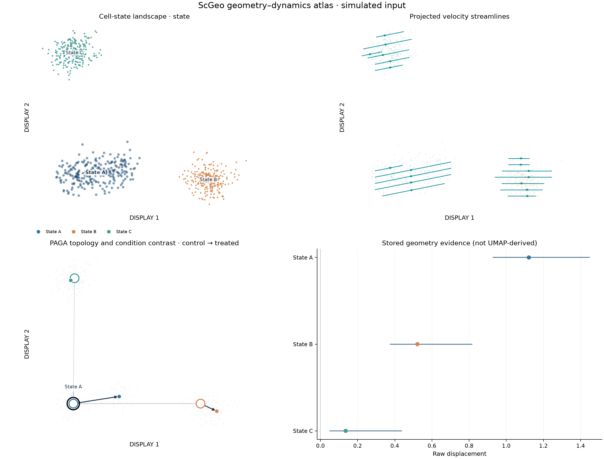

# One entry point for ScGeo geometry and dynamics figures

`scgeo.pl.geometry_dynamics_atlas()` composes existing single-cell views into a
publication-ready Matplotlib figure and returns the same inspectable `PlotResult`
used throughout ScGeo. It works with ordinary AnnData, requires **no new
analysis**, and adds panels only when their inputs are available.

[Plotting overview](PLOTTING.md) · [PAGA shift-map guide](PAGA_SHIFT_MAP.md) ·
[Projected velocity fields](VELOCITY_FIELDS.md) · [State evidence](RESULT_INTERPRETATION.md) ·
[Full plotting API](api/pl.md) · [Citing ScGeo](CITING.md)

> **Development API:** This function is currently available in the source
> checkout containing this guide; the published `scgeo==0.1.0` wheel does not
> contain it. Install the development checkout (`python -m pip install -e .`)
> or pin a reviewed commit. No manuscript-private results are needed.

## Actual gallery output



*Generated by [the executable atlas gallery](../examples/geometry_dynamics_atlas_gallery.py) in CI. The example uses simulated state groups, analytic projected vectors, a supplied synthetic undirected graph, and stored ScGeo effects computed on a simulated latent representation. It is not a biological result or an inferred lineage.*

## Quick start: standard Scanpy-compatible AnnData

```python
import scgeo as sg

# Already prepared by Scanpy or another upstream method:
# adata.obsm['X_umap'] and adata.obs['cell_type']
result = sg.pl.geometry_dynamics_atlas(
    adata,
    basis='umap',
    color='cell_type',
    panels='auto',
    show=False,
)
result.save('figures/cell_states', formats=('png', 'svg', 'pdf'), dpi=300)
```

Only the `states` panel is present when no matching velocity projection,
contrast-ready PAGA graph or explicit state report is available. The returned
metadata lists every omitted panel and why. The function **never** generates a
velocity field, PAGA graph or geometric displacement estimate from UMAP alone.

## Add existing dynamics, topology, and stored evidence

```python
# Required for a projected-velocity panel:
# adata.obsm['X_umap'] and shape-matched adata.obsm['velocity_umap']
# Required for the PAGA shift map:
# adata.uns['paga']['connectivities'], adata.obs['cell_type'],
# and a specified condition contrast.
# Optional: a precomputed ScGeo state report (no analysis run inside plotting).
report = sg.get.state_report(adata, node_key='cell_type')

result = sg.pl.geometry_dynamics_atlas(
    adata,
    basis='umap',
    color='cell_type',
    node_key='cell_type',
    condition_key='condition',
    group0='reference',
    group1='perturbed',
    sample_key='sample_id',       # optional; descriptive counts only
    report=report,               # optional; stored effects only
    panels=('states', 'velocity', 'paga', 'evidence'),
    velocity_mode='stream',      # 'grid' is also supported
    velocity_options={
        'grid_size': 26, 'n_neighbors': 30,
        'min_neighbors': 6, 'min_coherence': 0.2,
    },
    paga_options={
        'graph_node_order': list(adata.obs['cell_type'].cat.categories),
        'min_cells': 15,
    },
    highlight_states=['a_state_of_interest'],
    effect_metric='delta_norm',
    style='paper',
    max_points=6000,
    return_result=True,
    show=False,
)
result.save('figures/geometry_dynamics', formats=('pdf', 'svg', 'png'), dpi=300)
```

Replace keys and labels with your real metadata. `sample_key` is **optional**
(not restricted to mice, donors, or any other organism), and its presence only
adds sample counts. This figure does not compute a sample-level hypothesis test.

With `panels='auto'`, exactly two observed conditions can infer the contrast;
the choice is recorded in metadata. **Specify `group0` and `group1` for
scientifically intentional direction**, especially with more than two groups.
When explicit panels are requested, missing prerequisites raise a clear error
instead of drawing a misleading substitute. `panels=('states','geometry')`
is accepted as an alias for the PAGA panel.

## What every panel actually represents

| Panel | Required input | Interpretation |
|---|---|---|
| `states` | Embedding such as `X_umap` | Cells arranged in the supplied display space, colored by an `adata.obs` column (categorical or numeric) |
| `velocity` | Matching `velocity_umap`, or `velocity_<basis>` | Local interpolation of **already projected** vectors, with support/coherence masks; no kinetics, pseudotime or trajectories are fitted |
| `paga` | Existing PAGA connectivities, state labels and two conditions | **Undirected** connectivity and display-coordinate reference/comparison centers; not inferred cell transitions |
| `evidence` | Explicitly supplied precomputed ScGeo state report | Stored raw/normalized displacement magnitudes, eligibility and matching stored intervals, never estimated from UMAP positions |

The embedding limits are shared across the first three panels. Categorical
colors reuse Scanpy's `adata.uns['<color>_colors']` when present and valid,
otherwise they use ScGeo's deterministic label palette. Provide an explicit
`palette` for curated publication colors. When `color` is the same as
`node_key`, the PAGA nodes and
evidence markers reuse the state colors. If `color` is numeric, its colorbar is
specific to the states panel. The PAGA layout remains an overlay of the original
existing graph; it does not alter topology or group counts.

The plotted `evidence` rows must refer to states in the current object. If a
stored report declares a different contrast or node key, the atlas rejects it.
Raw `magnitude_ci95_*` intervals appear **only with raw `delta_norm`**;
normalized effects need their own
`normalized_magnitude_ci95_low/high` intervals. Missing or insufficient-status
states remain in the exported report, never silently promoted to evidence.

### Underlying plotting functions stay independently usable

This is a **figure composer**, not a replacement for `velocity_field`,
`paga_shift_map`, `state_evidence_panel`, or `geometry_velocity_concordance`.
Use the specialized functions for deeper interpretation. The atlas invokes
`velocity_field` and `paga_shift_map` with matching canvas settings and keeps
their full numeric source tables in its exported `PlotResult`. It uses a compact
stored-report panel rather than reproducing every evidence track in the larger
`state_evidence_panel`.

## Selective, reproducible, publication-ready output

```python
result = sg.pl.geometry_dynamics_atlas(
    adata,
    basis='umap', color='cell_type',
    panels=('states', 'velocity'),
    max_points=4000, random_state=27,
    show=False,
)
print(result.axes.keys())
print(result.metadata['omitted_panels'])
result.save('figures/atlas', formats=('png', 'svg', 'pdf'), dpi=300)
```

`max_points` affects **drawing only**, not the interpolated velocity field,
state centers or stored effect estimates. The export includes a full cell table
with a `displayed` flag, velocity-support grids and paths when applicable,
PAGA edge tables and reasons, selected/unselected evidence rows, figure hashes,
settings, and input-provenance fields. The figure does not overwrite AnnData.

Explicit options can be supplied through `velocity_options` and `paga_options`.
Atlas-managed settings such as embedding basis, axes, condition scope and
palette cannot be overridden by those dictionaries; use the top-level atlas
arguments instead. Stable axis limits are not an instruction to reinterpret
UMAP distances as effect sizes or velocity coherence as statistical certainty.

## Executable gallery and independent public-data checks

```bash
python -m pip install -e .
python examples/geometry_dynamics_atlas_gallery.py \
  --output-dir results/geometry_dynamics_atlas

# Optional: use existing, checksum-matched public files, without downloads.
python examples/geometry_dynamics_atlas_gallery.py \
  --pbmc /data/pbmc3k_processed.h5ad \
  --pancreas /data/cellrank_pancreas_preprocessed.h5ad \
  --output-dir results/geometry_dynamics_public
```

The default example simulates three states, multiple conditions and samples,
a **linear** display projection, an explicit symmetric PAGA graph and analytic
velocity vectors; it separately calculates a synthetic ScGeo state report.
It does **not** fit a UMAP, PAGA topology or biological trajectory. The
public-data paths use unchanged Scanpy PBMC3k annotations/UMAP and CellRank
pancreas UMAP/velocity. PBMC3k has no fabricated velocity or condition panel;
the pancreas example reuses existing upstream vectors without a refit.
Neither public input is downloaded by this script. Source hashes are checked
before reading, and private institutional datasets are never required.

The gallery, API manifest, synthetic regression tests, and Python packaging
checks are part of the PR. If you use ScGeo in a study, cite the
[software paper and exact version](CITING.md) in addition to any upstream
Scanpy/scVelo methods used to calculate the inputs.
