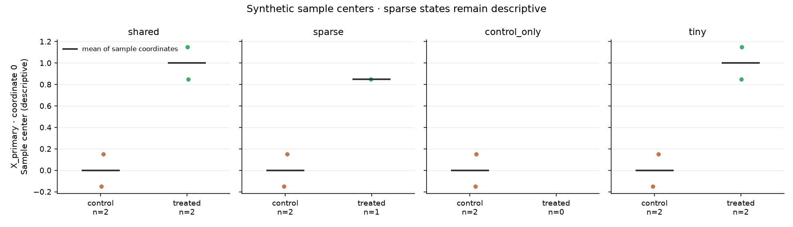

# JupyterHub installation and deployment preflight

This procedure prepares a **new, isolated Python environment and uniquely named
kernel**. It does not replace a working kernel, change the server environment,
access private data or reproduce a manuscript checkpoint. Software checks are
not biological validation. The plotting upgrade is merged in
[PR #22](https://github.com/liuifrec/scgeo/pull/22) at
`bd0c2406b41bf29964c630580e54c5c01b8e8299`; the deployment tools described here
require the subsequent, explicitly approved deployment commit.

## Install an approved commit

Run in a JupyterHub terminal on Linux. Obtain the **full 40-character approved
commit** from the reviewed PR; do not substitute `main`, a tag, `main.zip` or
a version-only PyPI installation when validating an exact source deployment. Older development checkouts could share the 0.1.0 release version; the 0.2.0 source bumps that version, but version alone still does not prove source identity. Python 3.12 is the deployment baseline; core CI also covers 3.9.
Python, Git and outbound access for this installation must already be available.

```bash
set -euo pipefail
export SCGEO_COMMIT=REPLACE_WITH_APPROVED_40_CHARACTER_COMMIT
[[ "$SCGEO_COMMIT" =~ ^[0-9a-f]{40}$ ]]
export SCGEO_SRC="$HOME/scgeo-deploy/source-$SCGEO_COMMIT"
export SCGEO_ENV="$HOME/scgeo-deploy/env-$SCGEO_COMMIT"
export SCGEO_RECORDS="$HOME/scgeo-deploy/records-$SCGEO_COMMIT"
export SCGEO_KERNEL="scgeo-${SCGEO_COMMIT:0:12}"
# Stop rather than reusing an environment or checkout.
test ! -e "$SCGEO_SRC"
test ! -e "$SCGEO_ENV"
mkdir -p "$SCGEO_RECORDS"
git clone https://github.com/liuifrec/scgeo.git "$SCGEO_SRC"
git -C "$SCGEO_SRC" checkout --detach "$SCGEO_COMMIT"
python3.12 -m venv "$SCGEO_ENV"
"$SCGEO_ENV/bin/python" -m pip install "$SCGEO_SRC" ipykernel
"$SCGEO_ENV/bin/python" -m pip check
# Run outside the checkout, so the import must come from this environment.
cd "$SCGEO_RECORDS"
"$SCGEO_ENV/bin/python" "$SCGEO_SRC/scripts/deployment_preflight.py" \
  --source-root "$SCGEO_SRC" --expected-commit "$SCGEO_COMMIT" \
  --require-optional ipykernel --output "$SCGEO_RECORDS/environment.json"
"$SCGEO_ENV/bin/python" -m pip freeze --all > "$SCGEO_RECORDS/requirements-resolved.txt"
```

The package installs as a wheel in the new environment. Keep the clean checkout
as its byte-for-byte verification reference. No editable import or path injection
is needed. Add only required extras in this **new** environment, for example
`"$SCGEO_ENV/bin/python" -m pip install "$SCGEO_SRC[scanpy]"`; rerun preflight
with `--require-optional ipykernel scanpy` afterwards. Geometry and these synthetic
checks do not require Scanpy, scVelo, Census, JupyterLab or private datasets.

Register the kernel only after preflight passes. IPython overwrites an existing
kernel with the same name, so this guard checks all visible kernel names first:

```bash
"$SCGEO_ENV/bin/python" - <<'PY'
import os
import subprocess
import sys
from jupyter_client.kernelspec import KernelSpecManager
name = os.environ["SCGEO_KERNEL"]
if name in KernelSpecManager().find_kernel_specs():
    raise SystemExit(f"Kernel {name!r} already exists; choose a new SCGEO_KERNEL name.")
subprocess.run([sys.executable, "-m", "ipykernel", "install", "--user",
                "--name", name, "--display-name", f"ScGeo ({os.environ['SCGEO_COMMIT'][:12]})"], check=True)
PY
```

Select that kernel in JupyterHub and start a new notebook. If a Hub restricts
user kernels, ask its administrator to expose this kernel; do not install into
the Hub's Python. These steps follow the official
[Python venv](https://docs.python.org/3/library/venv.html) and
[IPython kernel installation](https://ipython.readthedocs.io/en/stable/install/kernel_install.html)
instructions. Do not copy an existing virtual environment between machines.

Verify again **inside the selected notebook kernel** (terminal environment
variables need not be inherited by the Hub):

```python
from pathlib import Path
import runpy
import sys
commit = "REPLACE_WITH_APPROVED_40_CHARACTER_COMMIT"
source = Path.home() / "scgeo-deploy" / f"source-{commit}"
expected_environment = Path.home() / "scgeo-deploy" / f"env-{commit}"
assert Path(sys.prefix).resolve() == expected_environment.resolve(), "Select the separate ScGeo kernel first"
verify = runpy.run_path(str(source / "scripts/deployment_preflight.py"))["environment_report"]
environment = verify(expected_commit=commit, source_root=source,
                     require_optional=["ipykernel"])
print(sys.executable, environment.get("scgeo"), environment["errors"])
assert environment["ok"]
```

Preflight never changes `sys.path`, installs anything or repairs an environment.
It reports import failures, dirty/wrong commits, modified/missing/extra Python
sources, actual `scgeo.__file__`, distribution versions, required optional imports,
`pip check`, and a tiny sparse AnnData/obsm probe. Its sorted package inventory
omits credentials and direct-install URLs. Preserve the local `pip freeze` file
securely: it can contain local paths or repository URLs. A resolved inventory is
not a cross-platform lock or an upstream binary checksum; reproduce with the
same Python/platform, archived dependencies where necessary, and rerun checks.
Preflight verifies source files on disk. Restart the kernel after any code or
environment change; it cannot authenticate already-executing Python objects.

## Check an explicit AnnData input contract

Load only your authorized local AnnData object. This getter reads `obs`, `obsm`
and `uns`, does not read `X`, layers or raw, and never runs an analysis or changes
the object. Numeric coordinate checks inspect all supplied coordinate entries;
large backed objects should expose the requested small representations in memory.

```python
import scgeo as sg
config = {
    "purpose": "sample_inference",  # or "descriptive"
    "design": "independent",        # an explicit study-design assertion
    "state_key": "state", "condition_key": "condition",
    "group0": "control", "group1": "treated", "sample_key": "sample",
    "reps": ["X_primary", "X_alternative"],
    "methods": ["robust_shift", "representation_stability", "local_geometry_stability", "plotting"],
    "bootstrap_unit": "sample", "min_cells": 20,
    "min_samples_per_condition": 2, "k_values": [15],
    "embedding_key": "X_display",
    "representation_provenance": {
        "X_primary": "replace with actual method, parameters and input identity",
        "X_alternative": "replace with actual origin and dependence on X_primary",
    },
}
contract = sg.get.input_contract(adata, config=config)
print(contract["checks"], contract["state_coverage"])
assert contract["ok"]
# Proceed only for the intended states, after reviewing the design and warnings.
print(contract["eligible_states"], contract["excluded_states"])
```

Use your **actual keys, groups, representations and planned coverage thresholds**;
these example names are not defaults or a biological prescription. Unknown
configuration keys are errors. Missing/nonfinite coordinates, colliding labels,
absent groups and inconsistent sample identities are reported without imputation.
Observed labels are checked before the string convention used by existing
analysis methods. The supported sample-inference design is independent samples
nested in conditions; paired/repeated-measures designs require separate review.
`sample_key` is the biological unit, not a cell, technical lane, batch or animal
name inferred by this utility. Metadata cannot prove biological independence.

`ok` validates the requested inputs. **It does not make every state eligible.**
The report retains zero sample/state counts, missing conditions, insufficient
cells and insufficient samples. Thresholds screen input coverage; they do not
change validated estimands or promise power. Each represented sample counts once,
even if it contributes few cells; review the exported `sample_counts` explicitly.
For descriptive plots, use `purpose="descriptive"`, `sample_key=None` when no
sample identities exist, and `bootstrap_unit="auto"`. Such reports never claim
sample-inference eligibility.

Optional contracts are opt-in, with exact names and recorded provenance:

```python
config["projected_velocity"] = {
    "key": "velocity_display", "basis": "X_display",
    "provenance_uns_key": "projection_provenance",
}
# Existing adata.uns['projection_provenance'] must identify basis,
# velocity_key and a nonempty source. Do not manufacture provenance to pass.
config["paga"] = {"key": "paga", "node_order": ["state_A", "state_B"]}
# Existing adata.uns['paga'] must contain groups='state', matching node_order,
# source and finite, nonnegative, symmetric connectivities.
config["evidence"] = {
    "robust_shift": {"method": "robust_shift", "params": {
        "rep": "X_primary", "by": "state", "sample_key": "sample",
        "condition_key": "condition", "group0": "control", "group1": "treated",
        "resolved_bootstrap_unit": "sample",
    }},
}
contract = sg.get.input_contract(adata, config=config)
```

The velocity contract checks the plotting key convention and full matrix shape
against its declared display basis. These assertions do not authenticate an
upstream projection. PAGA topology is undirected and carries no recovery or
trajectory direction. Current categorical order alone cannot establish original
graph order. Missing provenance is a blocker for that requested contract; use a
different explicit configuration if the intended plot does not need the evidence.

`evidence` maps stored `uns['scgeo']` keys to an explicit method and expected
parameter values. Supported methods are `robust_shift`, `representation_stability`
and `local_geometry_stability`. It checks result containers and those explicit
parameters, never recomputes missing output or audits all table values.
Inventory alone is not a validity certificate. Inspect stored tables with
`sg.get.state_report(..., strict=True)` and preserve input hashes, analysis
configuration and the source commit: parameter matches cannot detect all stale
results. Local reports may contain sample labels; keep real-study reports on the
authorized server. The committed example report contains synthetic labels only.

## Synthetic acceptance check

The [recorded synthetic validation](validation/deployment_readiness_20261119.json)
was generated from implementation commit
`0fa43edcb582141e8f4c454dbfeb398c54063aee` in a fresh Python 3.12 environment.
The core wheel, AnnData probe, declared inputs, stored evidence and source export
checks passed. The two PNG previews were visually inspected; the example below
is byte-identical to its recorded export.



```bash
"$SCGEO_ENV/bin/python" "$SCGEO_SRC/examples/deployment_smoke.py" \
  --source-root "$SCGEO_SRC" --expected-commit "$SCGEO_COMMIT" \
  --output-dir "$SCGEO_RECORDS/synthetic"
```

The [fixture and runnable smoke test](../examples/deployment_smoke.py) use four
synthetic independent samples, two per condition, and four states with unequal
coverage. Only `shared` passes the sample-inference coverage screen. `sparse`,
`control_only` and `tiny` remain excluded for different explicit reasons. The
known equal-sample mean displacement is `[1, 0]`; unequal cell counts must not
change it. The rotated representation checks coordinate-safe sensitivity, not
independent biological confirmation. The six 2-vs-2 treatment-label assignments
are enumerated only for validation. Complementary allocations share the same
unsigned statistic; there is no significance claim or new permutation method.

The smoke calls the unchanged `tl.robust_shift`, `tl.representation_stability`
and `tl.local_geometry_stability` explicitly, then inspects stored results,
checks evidence parameters, and exports two figures in PNG/SVG/PDF with source
tables and SHA-256 manifests. The read-only checker itself never calls these
methods. `robust_shift` can return a descriptive estimate with sparse coverage;
the contract still excludes that state from sample inference. State-report
`inference_level` identifies the resampling unit; also inspect `coverage_status`
and the contract. Local geometry describes pooled neighborhood preservation,
not a treatment effect or its significance.

Acceptance requires `environment_verified`, `contract_passed` and
`source_hashes_verified` in `validation.json`, the expected coverage exclusions,
and human inspection of the exported figures. The full environment, exact
commit, input digest, state report and export provenance are in that JSON.
`validation-summary.json` is a portable subset with relative artifact names,
core versions, numerical expectations and hashes. It can be regenerated from
the recorded commit; image hashes additionally depend on the recorded rendering
stack and fonts.
The regression suite exercises wrong-source same-version imports, dirty
checkouts, incompatible inputs and sample-level safeguards. CI uploads this
synthetic report and figures; private datasets and manuscript artifacts are
outside this validation scope.
