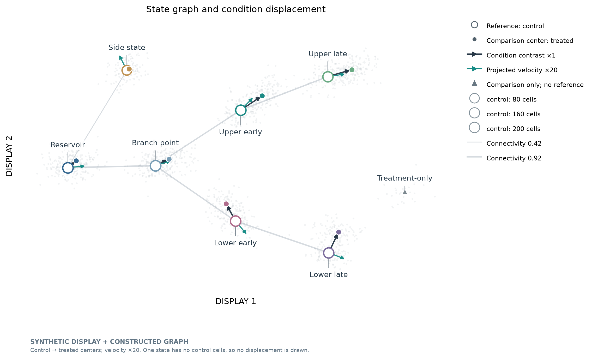
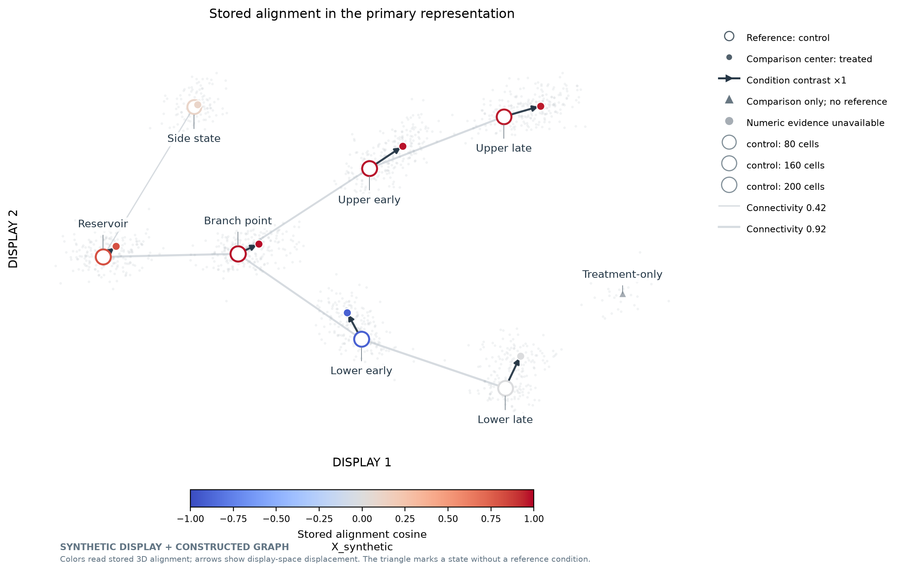
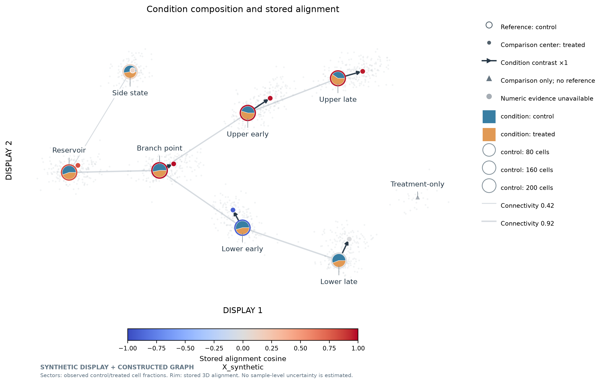

# State graphs, condition shifts, and stored alignment

`scgeo.pl.paga_shift_map` places a supplied state graph on an embedding and
shows how each state's display center differs between two conditions. Use the
same canvas to inspect condition endpoints, stored geometric alignment,
observed cell composition, and a compatible projected velocity overlay.

[Plotting guide](PLOTTING.md) · [Plotting API](api/pl.md) ·
[Local velocity fields](VELOCITY_FIELDS.md) · [Interpretation](RESULT_INTERPRETATION.md) · [Citation guide](CITING.md)

## See the result



**This preview is fully synthetic.** Its coordinates are a declared linear
projection of generated three-dimensional data, and its edges are a constructed
symmetric topology fixture. No UMAP embedding, PAGA graph, or RNA-velocity model
was fitted. ScGeo does compute the stored quantitative evidence from those
synthetic coordinates using four independent samples per condition.

The example includes eight states, anisotropic cell clouds, modest injected
condition shifts, and a state with no control cells. A third context condition
has deliberately different coordinates and velocities; it is excluded from
the selected control-versus-treated summaries.

## Run the offline gallery

These additions are **unreleased development features**. They require the
source checkout containing this guide; the published `scgeo==0.1.0` package
does not include them.

```bash
python -m pip install -e .
python -m pip check
git rev-parse HEAD
python examples/paga_shift_map_gallery.py --output-dir results/paga_shift_map
```

The example needs only ScGeo's core dependencies and downloads nothing. It
exports four figures as PNG, SVG, and PDF, together with source tables and JSON
metadata. To render only PNG previews:

```bash
python examples/paga_shift_map_gallery.py \
    --output-dir results/paga_shift_map --formats png
```

| Output stem | What it demonstrates |
|---|---|
| `paga_shift_map_overview` | State topology, actual condition endpoints, and compatible projected velocity |
| `paga_shift_map_alignment` | Stored alignment from one explicitly selected quantitative representation |
| `paga_shift_map_composition` | Observed control/treated cell fractions with the stored alignment retained on each pie rim |
| `paga_shift_map_focus` | A supplied Matplotlib axis, shared limits, selected highlights, and fewer labels |

Record the checkout commit with the exported files. The script places its
simulation design, seed, graph-row order, representation roles, and coordinate
scope in each result's `synthetic_fixture` metadata entry.

## Choose the display and the graph explicitly

For an existing analysis, supply your genuine embedding and the exact state
order used to construct its connectivity matrix:

```python
import scgeo as sg

# adata already contains X_umap and the stored graph.
# graph_order is the row/column order recorded when that graph was created.
result = sg.pl.paga_shift_map(
    adata,
    node_key="cell_type",
    condition_key="condition",
    group0="control",
    group1="treated",
    basis="umap",
    paga_key="paga",
    graph_node_order=graph_order,
    background="contrast",
    show_endpoints=True,
    return_result=True,
    show=False,
)
```

The graph matrix must have a unique, complete row/column label mapping. Its
shape, labels, and recorded grouping must agree with the requested state key.
If categorical ordering has changed since graph construction, the current
category order is not sufficient evidence of the original matrix order. Pass
the recorded `graph_node_order`; do not sort observed labels and assume they
match the matrix. A graph may include states absent from the current object,
but every observed state needs a graph label. Unplaceable or filtered edges
remain identifiable in the exported edge table.

`basis="umap"` and `basis="X_umap"` refer to the same stored embedding.
Other existing keys are supported. The gallery uses `basis="display"` because
its coordinates are deliberately constructed. The plotting function reads the
supplied graph and coordinates; it does not infer topology or recompute UMAP.

Edges represent the supplied connectivity values. Geometry-shift arrows
represent a condition contrast within a state. They do not trace observed
single-cell movement or establish a lineage relationship.

## Keep display centers and quantitative evidence distinct

The geometry arrows connect **cell-level mean or median centers in the display
coordinates**, selected through `agg="mean"` or `agg="median"`. A projection can
change those distances and directions. These centers are distinct from the
sample-aware multivariate robust centers estimated by `sg.tl.robust_shift`.

The reference marker identifies the control center, and the comparison endpoint
identifies the actual treated center. `arrow_scale=1` preserves the displayed
center-to-center displacement. If arrows are enlarged, the treated endpoint
stays at the observed center; the scaled arrow tip is recorded separately in
the exported vector table.

Reference-node sizes describe **observed control-cell counts**, not the number
of biological samples. Comparison endpoints have their own marker size. The
synthetic example has four independent samples per condition, but that sample
count is not what a large reference node signifies.

`min_cells` controls whether a condition center has enough cells for the
requested comparison. A state missing one condition remains an availability
case: no missing center, displacement vector, or alignment is invented.
The gallery's treatment-only state makes this behavior visible: a triangle
marks its observed treated center, and it has no reference displacement arrow.
Edges without usable reference anchors are omitted from the display and
retain their omission reasons in the source table.

## Color the map by a stored scalar



```python
result = sg.pl.paga_shift_map(
    adata,
    node_key="cell_type", condition_key="condition",
    group0="control", group1="treated",
    basis="umap", graph_node_order=graph_order,
    node_color_mode="alignment",
    alignment_source="stored",
    analysis_rep="X_pca",
    cmap="coolwarm", vmin=-1, vmax=1,
    background="contrast",
    return_result=True, show=False,
)
```

This reads the selected representation's stored alignment table from
`adata.uns["scgeo"]["representation_stability"]`. The selected representation,
state key, and contrast must match the stored analysis. Use `analysis_rep`
explicitly when multiple representations are available. A missing alignment
is shown as unavailable; it is not substituted with zero or an arbitrary
category color.

Stored color values do not change when only the display embedding changes.
The map therefore communicates two linked but different quantities: colors
from a declared quantitative space, and arrows in the display space. Alignment
cosines use a diverging scale centered at zero with limits `[-1, 1]`.

For supplied alignment tables, use the existing `alignment_df` and
`alignment_source="provided"` interface and retain the table's representation
and analysis provenance. Do not treat a table of display-space cosines as
high-dimensional evidence. An external table does not cause ScGeo to rerun or
validate the scientific analysis that produced it.

The example's rotated representation is an orthogonal view of the same
synthetic data. It is labeled as a related sensitivity view, not independent
validation.

## Add a compatible velocity overlay

```python
result = sg.pl.paga_shift_map(
    adata,
    node_key="cell_type", condition_key="condition",
    group0="control", group1="treated",
    basis="umap", graph_node_order=graph_order,
    show_velocity=True,
    velocity_basis="umap",  # reads velocity_umap
    velocity_scale=20,
    velocity_color="#178C86",
    return_result=True, show=False,
)
```

Velocity coordinates must be compatible with the displayed embedding. A vector
in a PCA space cannot be drawn directly as a UMAP displacement. The example
uses the first two components of its synthetic vectors alongside the first two
components of its synthetic coordinates; no velocity projection is fitted.
By default, `velocity_basis=None` inherits the selected display basis and looks
for its matching projected-velocity key. Set an explicit matching basis when
you want the relationship to be visible in the call.

The default state overlay (`velocity_mode="state"`) aggregates velocity among
cells in the selected two conditions using the chosen mean/median rule. Other
conditions are excluded, even when `background="all"` displays them. This
descriptive aggregation is separate from any sample-aware calculation in the
stored quantitative analysis. Rows with non-finite projected-velocity
components are jointly excluded from that summary; its `n_velocity` field
records the usable count. Non-finite display coordinates within the selected
contrast are rejected before drawing for cells with nonmissing state labels.
Local grid and streamline modes instead use Gaussian-weighted local means,
independently of `agg`.

`velocity_scale` is a display multiplier, not a time estimate. The overview
explicitly labels its velocity vectors as multiplied by 20. Keep the same
multiplier and coordinate limits when comparing compatible views.

### Show local directions within states

The default `velocity_mode="state"` retains one projected vector at each
supported reference anchor. To inspect a local field, select a grid or
streamline layer:

```python
result = sg.pl.paga_shift_map(
    adata,
    node_key="cell_type", condition_key="condition",
    group0="control", group1="treated",
    basis="umap", graph_node_order=graph_order,
    show_velocity=True, velocity_mode="stream",
    velocity_options={
        "grid_size": 45,
        "n_neighbors": 30,
        "min_neighbors": 8,
        "min_coherence": 0.3,
        "stream_density": 1.0,
    },
    background="contrast", return_result=True, show=False,
)
```

The local layer uses only the selected two conditions and replaces the state
velocity arrows. Condition-contrast arrows and stored node colors retain their
meaning. The field can describe a comparison-only state when its projected
vectors have enough local support, even though that state has no estimable
two-condition shift.

`velocity_options` controls field neighborhoods and rendering. Grid arrows use
its `scale` option (`"auto"` by default); the existing `velocity_scale` parameter
continues to control state arrows. Streamlines encode local field direction,
with no time scale. Numeric field colors are available in the standalone
`pl.velocity_field` view; the PAGA layer uses `velocity_color` so the node's
quantitative colorbar stays unambiguous.

Pooling conditions may conceal opposing patterns. Use the
[matched-condition example](VELOCITY_FIELDS.md) to inspect conditions separately
with shared grid coordinates, support rules, and scales. Local coherence is a
descriptive measure of vector agreement, not statistical confidence. Full
local-field inputs, support grids, arrow endpoints, and streamline paths are
included in the PAGA result's `velocity_*` source tables.

### Migrate a historical velocity-overlay call

Some historical workflows combine `basis="umap_scanorama"` with
`velocity_basis="umap"`. Those keys identify different coordinate systems, so
the upgraded function rejects that combination when `show_velocity=True`.
Provide velocity genuinely projected into the displayed embedding:

```python
# Requires an existing, compatible velocity_umap_scanorama projection.
result = sg.pl.paga_shift_map(
    adata,
    node_key="cell_type", condition_key="condition",
    group0="control", group1="treated",
    basis="umap_scanorama", velocity_basis="umap_scanorama",
    graph_node_order=graph_order, show_velocity=True,
    return_result=True, show=False,
)
```

If that projection is unavailable, use `show_velocity=False`. Stored alignment
coloring can still refer to its declared quantitative representation. Renaming
an unrelated velocity array does not create a compatible projection. This
migration guidance does not alter or regenerate historical manuscript outputs.

## Combine observed composition with stored alignment



```python
result = sg.pl.paga_shift_map(
    adata,
    node_key="cell_type", condition_key="condition",
    group0="control", group1="treated",
    basis="umap", graph_node_order=graph_order,
    node_color_mode="alignment", alignment_source="stored",
    analysis_rep="X_pca",  # select the stored quantitative representation
    cmap="coolwarm", vmin=-1, vmax=1,
    pie_key="condition",
    pie_categories=["control", "treated"],
    pie_palette={"control": "#387EA3", "treated": "#E19954"},
    background="contrast",
    return_result=True, show=False,
)
```

Each pie has two separate encodings. **Sectors show observed cell fractions**
for the categories in `pie_key`, and **the rim retains the stored alignment
color** from the declared quantitative representation. The filled comparison
endpoint uses that same scalar color. A categorical legend explains the
sectors; the numeric colorbar explains the rim and endpoint. The gallery uses
`X_synthetic` and the same `coolwarm` scale and `[-1, 1]` limits as the alignment
view above.

Pies summarize composition among the selected contrast cells. Cells from a
third condition do not enter their denominators. Keep `pie_categories` and
`pie_palette` consistent across panels. Pies are drawn at usable reference
centers. A state with no reference cells retains its comparison-only marker;
its observed category counts remain in the exported composition source table.

These are cell-count summaries. They do not account for sample-to-sample
variation or provide sample-level abundance uncertainty. Use a suitable
biological-sample analysis for inferential claims about composition.

## Compose matching panels and control labels

```python
import matplotlib.pyplot as plt
from matplotlib.colors import TwoSlopeNorm

fig, axes = plt.subplots(1, 2, figsize=(12, 4.8), sharex=True, sharey=True)
# Fix axes geometry before collision-aware label placement.
fig.subplots_adjust(left=.07, right=.98, bottom=.13, top=.90, wspace=.24)
shared_norm = TwoSlopeNorm(vmin=-1, vcenter=0, vmax=1)
common = dict(
    node_key="cell_type", condition_key="condition",
    group0="control", group1="treated",
    graph_node_order=graph_order, background="contrast",
    node_color_mode="alignment", alignment_source="stored",
    analysis_rep="X_pca", norm=shared_norm,
    xlim=(-7, 8), ylim=(-5, 6),  # choose limits appropriate to your coordinates
    show_colorbar=False, legend=False,
    return_result=True, show=False,
)
left = sg.pl.paga_shift_map(adata, basis="umap", ax=axes[0], **common)
right = sg.pl.paga_shift_map(
    adata, basis="umap", ax=axes[1],
    highlight_nodes=["state_of_interest"], label_top_n=4,
    **common,
)
```

Set the final figure size and axes layout before plotting so automatic label
placement sees the intended canvas. If you resize or rearrange it afterward,
redraw the plot and review the labels.

Use shared limits only when the panels use compatible coordinates. Reusing
limits across unrelated embeddings does not make their positions comparable.
For a shared colorbar, pass a dedicated `cax=` to one plot with
`show_colorbar=True`, or add a colorbar to the composed figure yourself.

Automatic label placement is deterministic. `label_offsets` supplies explicit
`(dx, dy)` adjustments in points when a particular label needs more room:

```python
label_offsets = {"state_of_interest": (12, 18)}
```

Pass that mapping with `label_mode="auto"`, or use `label_mode="on_data"` for
labels at their state anchors. `label_top_n` prioritizes display-space shift
magnitude; it is not a ranking by statistical significance or an automatically
selected high-dimensional effect. Highlights are a separate, explicit choice.

`max_points` and `random_state` control reproducible background subsampling.
Sampling preserves state-by-condition display strata and requested cell
positions in `required_indices`. It affects displayed background points only;
centers, counts, graph edges, pie fractions, and stored colors use their full
eligible inputs. The returned table records which cells were actually shown.

## Export the figure and the values behind it

```python
result.save(
    "figures/state_graph",
    formats=("pdf", "svg", "png"),
    dpi=300,
    include_data=True,
    include_metadata=True,
)
```

`return_result=True` returns a `PlotResult` with named map/colorbar axes,
artists, source tables, warnings, and metadata. Source tables include condition
centers and counts, graph edges and filtering reasons, display-cell flags,
actual and scaled vector endpoints, and label offsets. Alignment, composition,
and velocity tables are included when those layers are requested.

The manifest records the plot configuration and source hashes. The gallery
adds explicit synthetic-coordinate and topology provenance. Include the
software version and checkout commit alongside the figure when reporting an
analysis; see the [citation guide](CITING.md).

Existing return conventions remain supported:

| Call | Return |
|---|---|
| Default, with a newly created figure | `(fig, ax)` |
| Default, with `ax=` supplied | `ax` |
| `return_data=True` | `(fig, ax, data)` |
| `return_result=True` | `PlotResult` |

Choose one return mode. Use the result object for consistent source-data
export. With a
caller-supplied axis or SubFigure, export may include the full parent canvas;
the result's tables cover its named axes, so preserve sibling panels' source
tables separately when composing a larger figure.
