# ScGeo plotting gallery

Actual output from the development plotting API on public single-cell data and
controlled synthetic examples. The public-data views exercise supplied
annotations, embeddings, and projected velocities; the synthetic examples make
specific display behaviors and known failure modes easy to inspect.

[Plotting guide](PLOTTING.md) · [API reference](api/pl.md) ·
[Public-data source](../examples/real_data_plotting_gallery.py) ·
[Synthetic source](../examples/plotting_gallery.py) · [PAGA shift maps](PAGA_SHIFT_MAP.md)

These additions are **unreleased**. Install the matching source checkout as
described in the plotting guide. To reproduce the public-data figures, use the
[real-data instructions](REAL_DATA_PLOTTING.md), including the explicit download
step or your local copies of the checksum-pinned input files. To run the
synthetic gallery without a dataset download:

```bash
python examples/plotting_gallery.py --output-dir results/plotting_gallery --formats png svg pdf
```

Each figure has source CSVs and a JSON manifest with plotting configuration,
software versions, available analysis metadata, and file hashes.

## Public PBMC data: annotation associations and rare categories

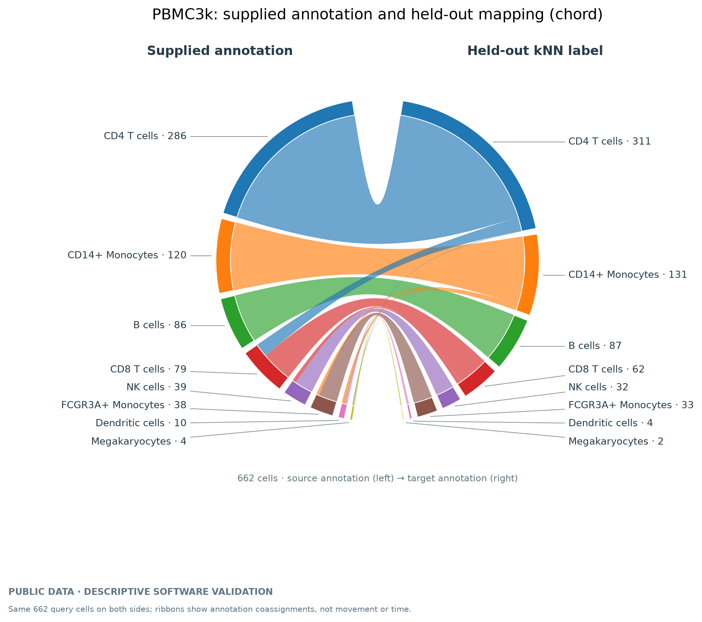

`state_flow_chord` gives two annotation columns distinct sides, proportional
node arcs, smooth ribbons, and separated label leaders. This actual PBMC3k
example keeps all positive links, including the rare Dendritic and
Megakaryocyte categories. Its companion `state_flow_alluvial` uses the same
counts and colors. Ribbons describe two labels on the same cells; they do not
establish transitions or lineage.

The reference/query split contains 1,976 and 662 cells, respectively. Of the
query cells, 618 have matching supplied and kNN labels and 44 differ. Mapping
uses the supplied PCA representation fitted upstream on the full dataset;
these are descriptive coassignments, not independent accuracy estimates.

See [state associations and density](STATE_FLOW_AND_DENSITY.md) for category
ordering, palettes, missing labels, and full-population count denominators.
The [real-data guide](REAL_DATA_PLOTTING.md) records the exact data sources,
split, mapping parameters, and interpretation limits.

## Public PBMC data: common intensity and relative shape

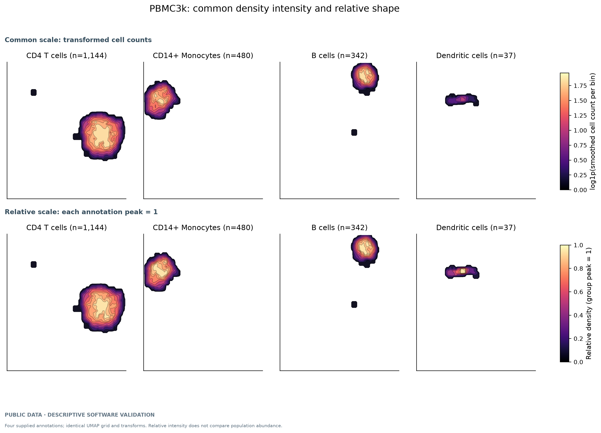

`embedding_density` uses identical UMAP bins and one smoothing/log transform
per panel. The upper row shares an absolute transformed-count scale. The lower
row sets each annotation's peak to one, revealing the shape of the 37-cell
Dendritic population without implying equal abundance. All 2,003 selected
cells reconcile to the exported raw grid counts in each row.

## Public pancreas data: an existing projected velocity field

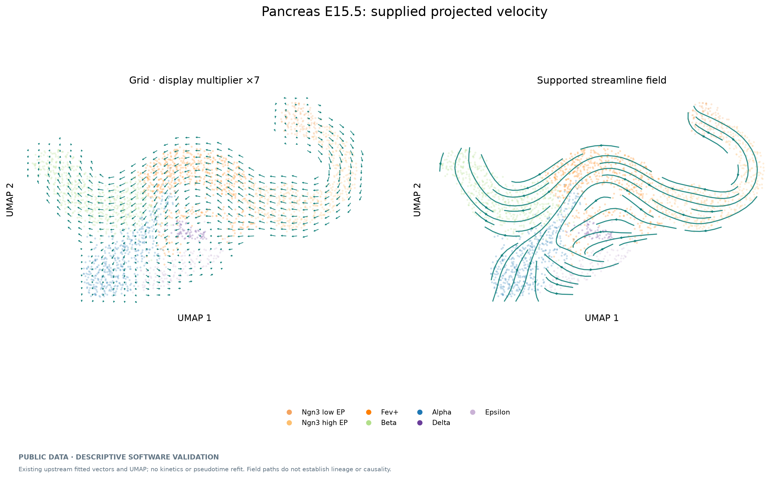

The CellRank preprocessed pancreas input supplies matching UMAP coordinates and
projected velocities for 2,531 cells. Both panels use the same field inputs and
support criteria. Grid arrows retain proportional lengths with a declared
display multiplier; streamlines trace the supported interpolated field.

The [runnable example](../examples/real_data_plotting_gallery.py) reuses the
upstream fitted vectors. It does not refit kinetics or infer a new trajectory.
This single-day input also provides no condition contrast or biological-sample
replication for a PAGA shift comparison. See the
[recorded validation](validation/real_data_plotting_20261117.json) for source
checksums, count audits, support diagnostics, and code hashes.

## Controlled synthetic examples

The remaining figures use explicitly constructed coordinates, samples, and
connectivity. They demonstrate the interfaces and their limits without making
biological claims.

## Local velocity with explicit support

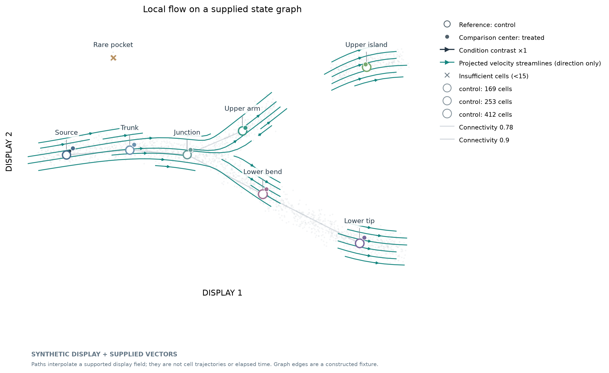

The [local velocity gallery](VELOCITY_FIELDS.md) adds grid arrows and
streamlines to an explicitly synthetic curved-branch fixture. It includes a
real coordinate gap, opposing vectors, and sparse observations to show how
support and directional-coherence masks affect the display. The matching
condition panels use common evaluation coordinates and scale settings.

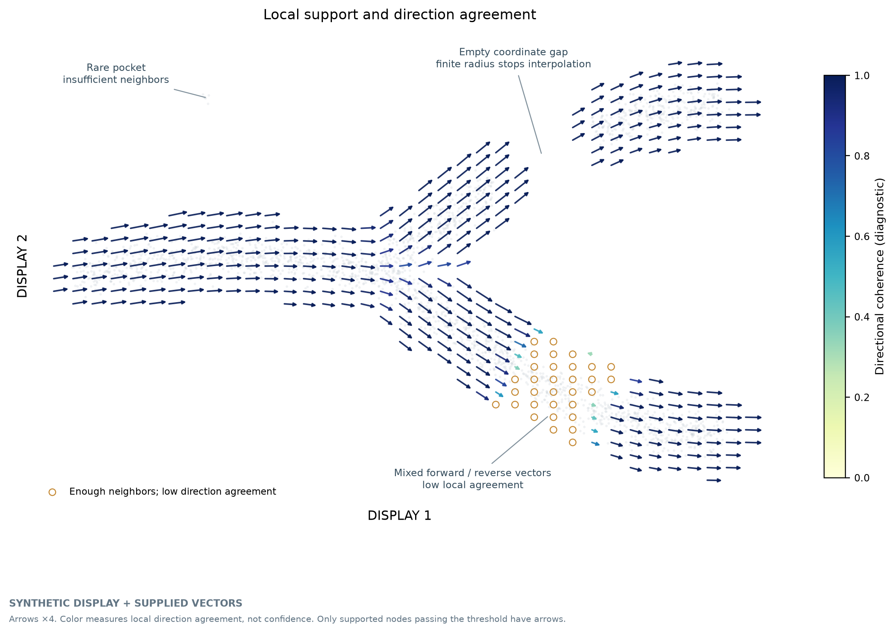

Run `examples/velocity_field_gallery.py` for these views and their exact source
tables. The vector field is interpolated from supplied projected velocities;
the example does not fit UMAP, PAGA, RNA kinetics, or biological trajectories.

## State connectivity, condition centres, and projected velocity

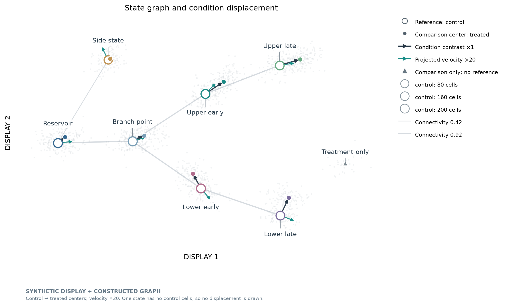

The [PAGA shift-map gallery](PAGA_SHIFT_MAP.md) demonstrates the upgraded
`paga_shift_map`, including stored alignment colours, composition pies, and
matched displays. Its synthetic coordinates and connectivity fixture are
declared explicitly; the graph is not an inferred biological trajectory.
Run `examples/paga_shift_map_gallery.py` to reproduce these additional views.

## Which states differ, and what evidence is available?


`state_evidence_panel` aligns raw magnitude, four simulated samples per
condition, representation consensus, and evidence availability. This first
snapshot precedes the gallery's local-geometry and dynamics analyses, so their
availability is shown explicitly. Magnitude intervals preserve their stored
endpoints and are not automatic significance tests.

## How do contrasts compare in a common coordinate system?

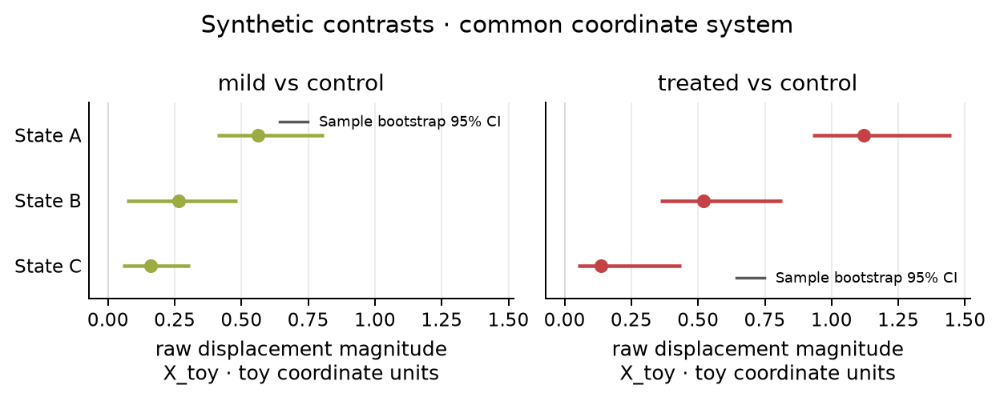

`evidence_comparison` draws both contrasts in the same simulated coordinate
system. Its interval legend identifies sample-bootstrap 95% intervals. Supply
different interval types explicitly when showing representation sensitivity;
the renderer never substitutes one uncertainty source for another.

## How much variation is present among biological samples?

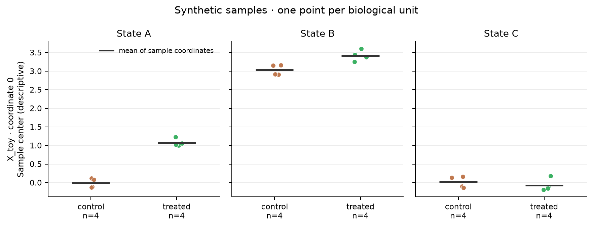

`get.sample_centers` retrieves the exact stored centers and `replicate_effect`
shows coordinate zero. Each point is one simulated sample. The mean shown is
a descriptive mean of sample coordinates, without a fitted interval or test.

## Does alignment agree across declared representation views?

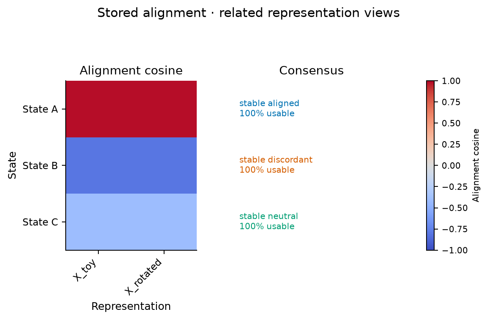

`representation_stability_heatmap` uses a fixed cosine scale centered at zero.
The original and rotated coordinates are related sensitivity views, not
independent validation. Their consensus labels are read from stored analysis.

## How does quantitative alignment relate to a display overlay?

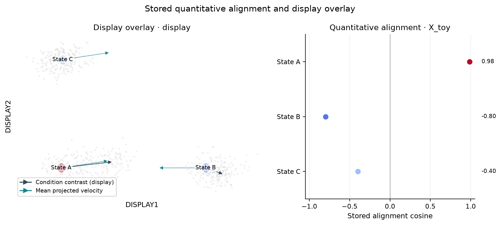

`velocity_shift_alignment(mode='stored')` retains the quantitative alignment
from `X_toy`. The separate display uses the first two coordinates and their
compatible projected velocities. These synthetic arrows describe condition
contrasts and supplied vectors, not observed longitudinal cell movement.

## Distinguish robustness from coverage

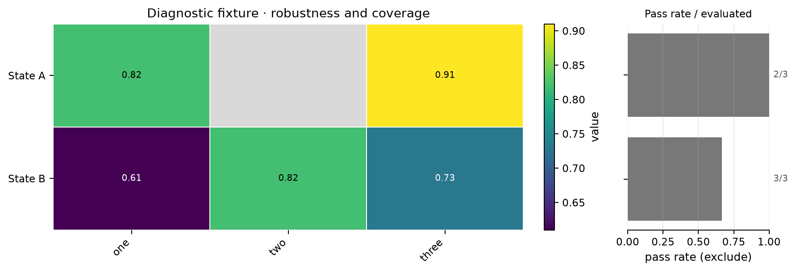

This deliberately constructed missingness fixture is separate from the geometry
example. Two passing settings and one unavailable setting give a pass rate of
2/2 among evaluated settings and evaluation coverage of 2/3. Use
`missing_policy='fail'` when the historical conservative denominator is intended.

## Additional generated views

The same example also exports `consensus_map`, `composition`, and
`local_geometry`. Their source tables let users inspect the plotted values.
The composition example is balanced by construction; it should not suggest an
abundance effect. The linear display and exact rotation are stated in metadata.

For custom panel assembly, plot styling, required-panel validation, large-cell
display sampling, and exact-size exports, use the [plotting guide](PLOTTING.md).
