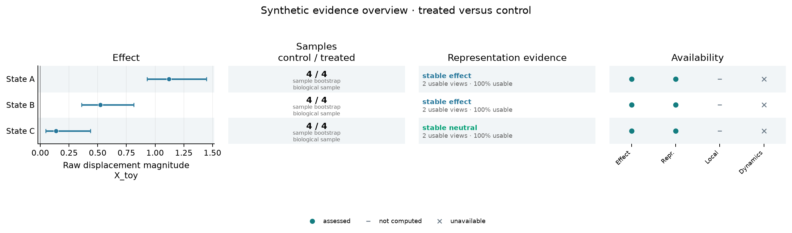

# ScGeo plotting gallery

Actual output from the development plotting API, generated with synthetic
coordinates and sample identities. The figures demonstrate interfaces and
interpretation, not biological findings.

[Plotting guide](PLOTTING.md) · [API reference](api/pl.md) ·
[Runnable source](../examples/plotting_gallery.py)

These additions are **unreleased**. Install the matching source checkout as
described in the plotting guide, then run:

```bash
python examples/plotting_gallery.py --output-dir results/plotting_gallery --formats png svg pdf
```

Each figure has source CSVs and a JSON manifest with plotting configuration,
software versions, available analysis metadata, and file hashes.

## Which states differ, and what evidence is available?



`state_evidence_panel` aligns raw magnitude, four simulated samples per
condition, representation consensus, and evidence availability. This first
snapshot precedes the gallery's local-geometry and dynamics analyses, so their
availability is shown explicitly. Magnitude intervals preserve their stored
endpoints and are not automatic significance tests.

## How do contrasts compare in a common coordinate system?


`evidence_comparison` draws both contrasts in the same simulated coordinate
system. Its interval legend identifies sample-bootstrap 95% intervals. Supply
different interval types explicitly when showing representation sensitivity;
the renderer never substitutes one uncertainty source for another.

## How much variation is present among biological samples?


`get.sample_centers` retrieves the exact stored centers and `replicate_effect`
shows coordinate zero. Each point is one simulated sample. The mean shown is
a descriptive mean of sample coordinates, without a fitted interval or test.

## Does alignment agree across declared representation views?


`representation_stability_heatmap` uses a fixed cosine scale centered at zero.
The original and rotated coordinates are related sensitivity views, not
independent validation. Their consensus labels are read from stored analysis.

## How does quantitative alignment relate to a display overlay?


`velocity_shift_alignment(mode='stored')` retains the quantitative alignment
from `X_toy`. The separate display uses the first two coordinates and their
compatible projected velocities. These synthetic arrows describe condition
contrasts and supplied vectors, not observed longitudinal cell movement.

## Distinguish robustness from coverage


This deliberately constructed missingness fixture is separate from the geometry
example. Two passing settings and one unavailable setting give a pass rate of
2/2 among evaluated settings and evaluation coverage of 2/3. Use
`missing_policy='fail'` when the historical conservative denominator is intended.

## Additional generated views

The same example also exports `consensus_map`, `composition`, and
`local_geometry`. Their source tables let users inspect the plotted values.
The composition example is balanced by construction; it should not suggest an
abundance effect. The linear display and exact rotation are stated in metadata.

For custom panel assembly, plot styling, required-panel validation, large-cell
display sampling, and exact-size exports, use the [plotting guide](PLOTTING.md).
