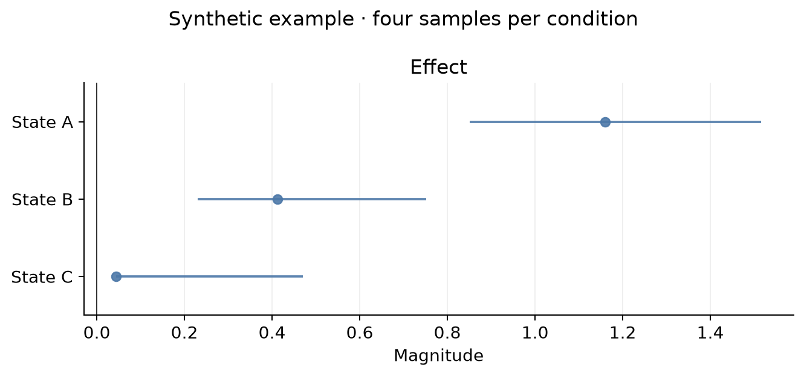

# Quick start: from AnnData to a state-level report

[Install](INSTALLATION.md) · [API reference](api_reference.md) · [Interpret results](RESULT_INTERPRETATION.md) · [Cite](CITING.md)

Start with a contrast between two conditions in one quantitative representation.
ScGeo estimates displacement for each annotated state and, when valid sample
identifiers are supplied, resamples biological samples to summarize uncertainty.
You can add other evidence layers after the first result is working.

## Try the complete example

The repository includes a small example that needs no data download, Scanpy,
RNA-velocity model, or Census connection. After installing core ScGeo, run from
a checkout:

```bash
python examples/quickstart.py --output-dir results/quickstart
```

Or open [examples/quickstart.py](../examples/quickstart.py) and copy its
`make_toy_data` function and analysis into your notebook. It creates **720
simulated cells, three states, and four independent simulated samples per
condition**. These are demonstration coordinates, not biological data.

The example calls `tl.robust_shift`, assembles `get.state_report`, and renders
`pl.state_evidence_panel`. It writes:

| File | Contents |
| --- | --- |
| `state_report.csv` | State-level displacement, sample counts, uncertainty, and evidence availability |
| `state_evidence_panel.png` and `.svg` | Plot of the estimated displacement with bootstrap interval displays |
| `metadata.json` | ScGeo version, seed, sample count, analysis settings, and synthetic-data scope |

With seed 7, the displacement magnitudes are approximately **1.160**, **0.412**,
and **0.044** for States A, B, and C. The sample count is four per condition and
the recorded bootstrap unit is `sample`. Minor numerical differences across
dependency versions are possible. These numbers illustrate the API only.



The example computes one evidence layer. Representation stability, local
geometry, and dynamics remain `not_computed` or unavailable in the report;
their absence is expected. A single-view result does not establish
cross-representation stability. Bootstrap intervals on a nonnegative magnitude
are resampling summaries, not automatic null-hypothesis tests.

## Use your own AnnData object

Provide these fields, replacing the example names with your own:

| Field | Meaning |
| --- | --- |
| `adata.obs["condition"]` | Contrast labels, here `control` and `treated` |
| `adata.obs["cell_type"]` | State or cluster identity |
| `adata.obs["sample"]` | Genuine biological-sample identity, such as independently sampled mice or donors |
| `adata.obsm["X_pca"]` | A finite cells-by-dimensions quantitative representation |

The observation rows and coordinates must describe the same cells in the same
order. Use the biological sampling unit supported by the experiment; conditions,
individual cells, and arbitrary partitions are not biological replicates.
Without valid independent sample identities, retain descriptive scope rather
than inventing a sample key.

```python
import scgeo as sg

sg.tl.robust_shift(
    adata,
    rep="X_pca",
    condition_key="condition",
    group0="control",
    group1="treated",
    by="cell_type",
    sample_key="sample",
    center="geometric_median",
    n_boot=500,
    seed=7,
)

report = sg.get.state_report(adata, node_key="cell_type")
print(report[["state", "delta_norm", "n_samples0", "n_samples1", "bootstrap_unit"]])
sg.pl.state_evidence_panel(report)
```

Results are stored under `adata.uns["scgeo"]`. `state_report` assembles the
available results into one row per state, retaining settings and missing-evidence
indicators. Save the report and the input/environment provenance alongside
your figures. See [Reproducibility](REPRODUCIBILITY.md).

## Add representation stability when another representation is available

The next step requires **additional precomputed quantitative coordinates** for
the same cells. For example, if `adata.obsm["X_scvi"]` already exists and both
representations are scientifically appropriate:

```python
if "X_scvi" in adata.obsm:
    sg.tl.representation_stability(
        adata,
        reps=["X_pca", "X_scvi"],
        node_key="cell_type",
        condition_key="condition",
        group0="control",
        group1="treated",
        sample_key="sample",
    )
    report = sg.get.state_report(adata, node_key="cell_type")
    sg.pl.state_evidence_panel(report)
```

ScGeo consumes the supplied representations; this call does not train scVI.
Prespecify the primary representation set before comparing results. Keep nested
PCA dimensions as related sensitivity views, and use UMAP for display. See
[Analysis layers](ANALYSIS_LAYERS.md) for ensemble roles and interpretation.

## Choose the next question

| Next question | Continue with |
| --- | --- |
| Are neighborhoods preserved across representations? | `tl.local_geometry_stability` in the [API reference](api_reference.md) |
| Do geometric shifts agree with an existing dynamics model? | `tl.velocity_shift_alignment`, with compatible supplied coordinates |
| Did cell-state proportions or distributions change? | `tl.paga_composition_stats` and `tl.distribution_test`; inspect the comparison unit and [feature dependencies](INSTALLATION.md#feature-specific-dependencies) |
| What language fits the evidence? | [Result interpretation](RESULT_INTERPRETATION.md) |
| How were the published workflows organized? | [Companion notebook guide](COMPANION_NOTEBOOKS.md) |
| How should the analysis be cited and reported? | [Citation and Methods guide](CITING.md) |
