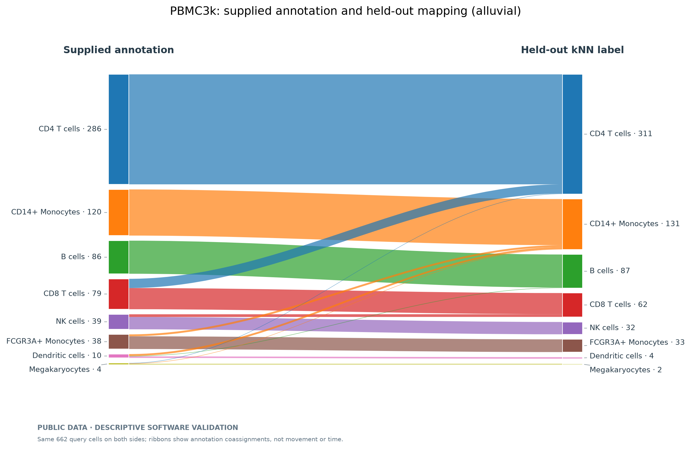
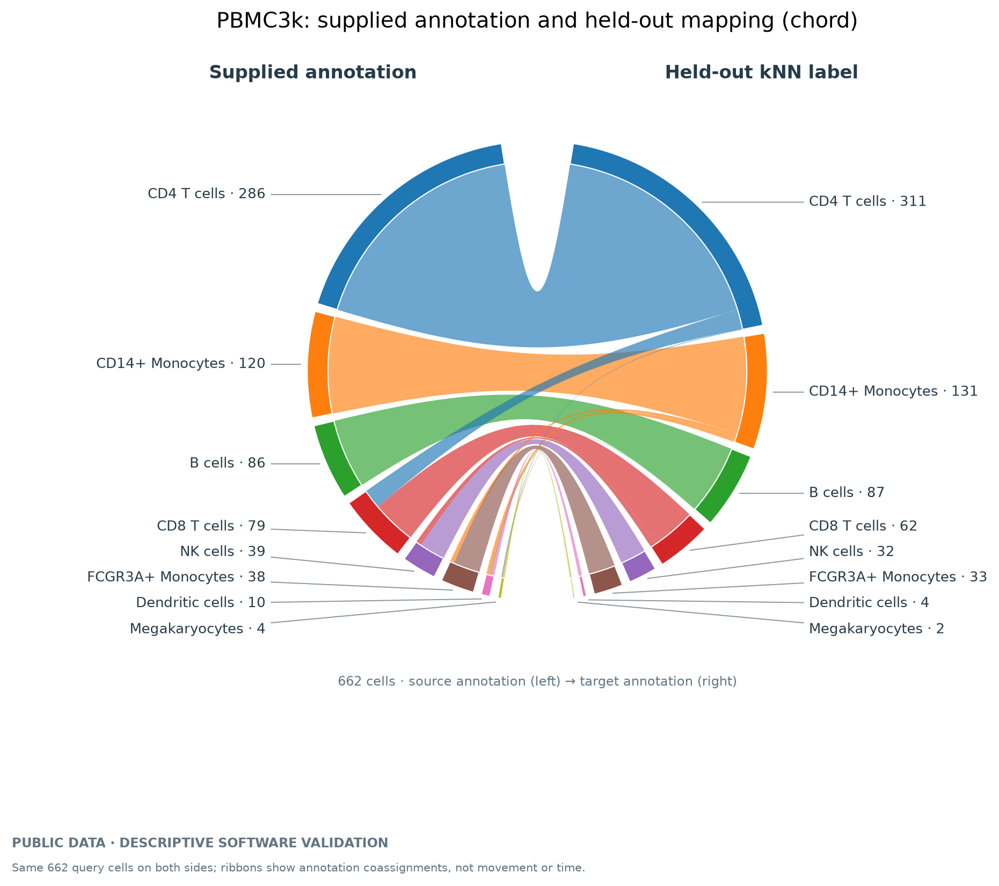
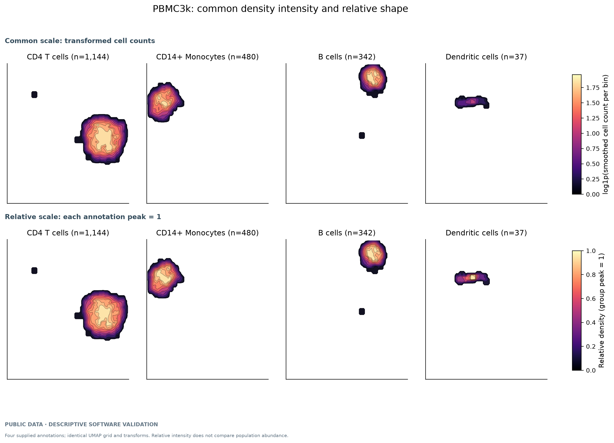
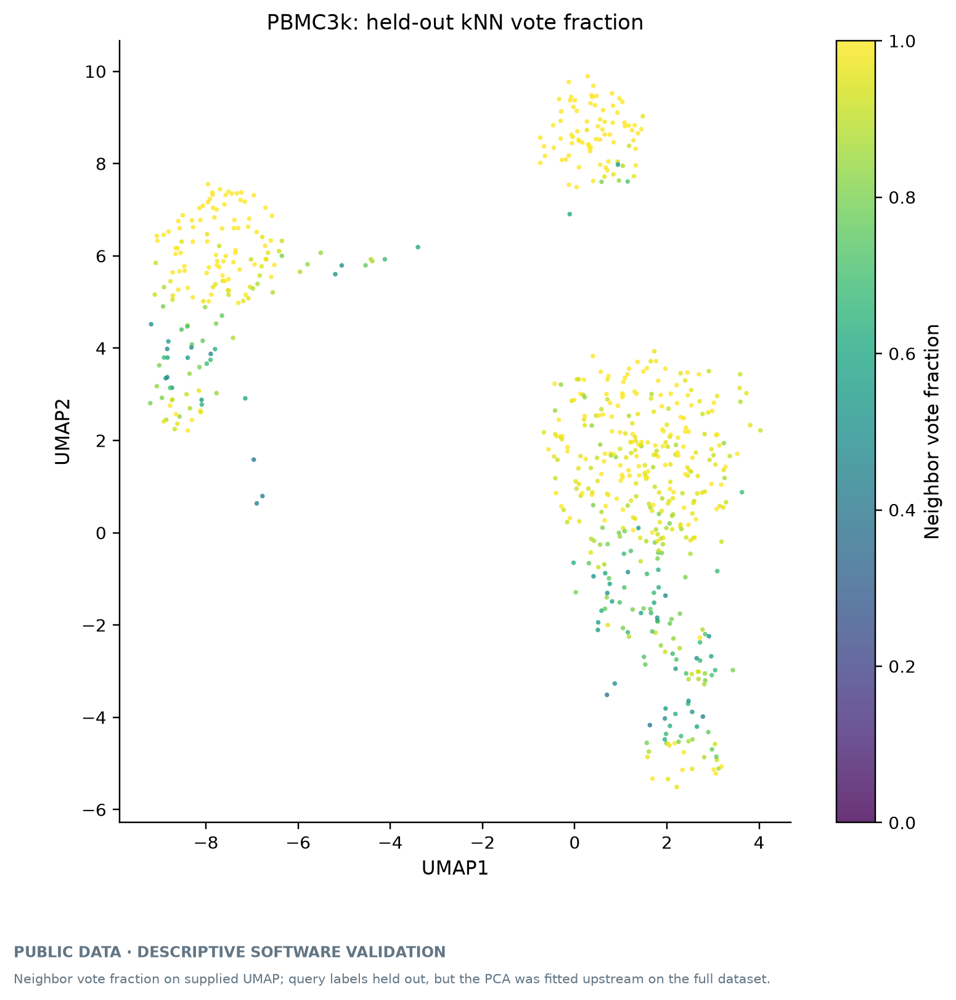
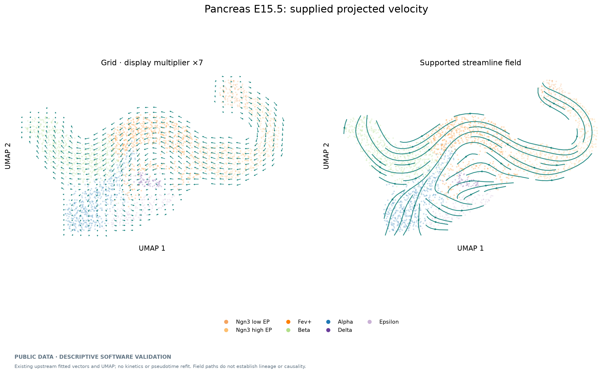

# Real-data plotting validation

Use the upgraded plotting API on public single-cell data with supplied
annotations, fitted embeddings, and, for the pancreas example, existing
projected velocity. The gallery records the exact downloaded bytes, preserves
cell identities, and separates data preparation from figure rendering.

[Plotting guide](PLOTTING.md) · [Velocity fields](VELOCITY_FIELDS.md) ·
[Plotting API](api/pl.md) · [Citation guide](CITING.md)

These examples exercise the 0.2.0 API and require the matching source checkout for the scripts. They are descriptive software checks, not new biological analyses or
independent benchmarks of annotation accuracy.

## Two public inputs, two distinct validation questions

| Input | Observed contents used here | Appropriate validation |
|---|---|---|
| [Scanpy processed PBMC3k](https://scanpy.readthedocs.io/en/stable/api/generated/scanpy.datasets.pbmc3k_processed.html) | 2,638 cells, eight supplied Louvain annotations, 50-dimensional PCA, UMAP, and QC columns | Same-cell annotation cross-tabs, internal label mapping, density scales, and numeric UMAP coloring |
| [CellRank preprocessed pancreas E15.5](https://cellrank.readthedocs.io/en/stable/api/_autosummary/datasets/cellrank.datasets.pancreas.html) | 2,531 cells, seven supplied cluster annotations, UMAP, and matching projected velocity from an upstream dynamical model | Rendering and support diagnostics for existing projected velocity |

The PBMC data originate from the 10x Genomics PBMC3k dataset and the Scanpy
preprocessing tutorial. Its supplied `louvain` column contains the tutorial's
cell-type annotations; it is not an independent ground-truth assay. The
pancreas input derives from the E15.5 data of Bastidas-Ponce and colleagues,
as distributed and documented by CellRank. Its recorded `day` is 15.5 for
every cell in this file.

Neither input supplies donor or biological-sample identities for this gallery.
Cell barcodes are retained as cell identifiers. The example does not manufacture
sample IDs, treatment groups, batches, temporal observations, or velocities.

## Reproduce the gallery

The script uses ScGeo's core dependencies. It does not import Scanpy, scVelo,
or CellRank at runtime. When both H5AD files are already present, preparation
and rendering run without network access.

```bash
python -m pip install -e .
python -m pip check
git rev-parse HEAD

python examples/real_data_plotting_gallery.py \
    --dataset all --stage prepare \
    --pbmc-h5ad /path/to/pbmc3k_processed.h5ad \
    --pancreas-h5ad /path/to/cellrank_pancreas_preprocessed.h5ad

python examples/real_data_plotting_gallery.py \
    --dataset all --stage render
```

To retrieve the pinned public inputs explicitly:

```bash
python examples/real_data_plotting_gallery.py \
    --dataset all --stage prepare --download
python examples/real_data_plotting_gallery.py \
    --dataset all --stage render
```

Downloads default to `~/.cache/scgeo/`, outside the repository. The script
downloads only missing files when `--download` is given and verifies the size
and SHA-256 before using them. It never replaces a mismatching existing file.
An upstream file change therefore produces a clear failure instead of silently
changing the validation dataset.

Use `--dataset pbmc` or `--dataset pancreas` to work with one dataset. The
default preparation cache is `results/real_data_plotting/prepared`; figures and
their CSV/JSON sources go to `results/real_data_plotting`. Override those paths
with `--prepared-dir` and `--output-dir`. Add `--formats png` for quick previews;
the default writes PNG, SVG, and PDF.

The preparation stage creates coordinate-and-observation AnnData containers,
with no expression matrix. This avoids rewriting the legacy source H5ADs and
preserves the supplied numerical coordinates exactly. Prepared files have
their own hashes, checked again before rendering. The raw files remain intact.

### Pinned public files

| Input | Primary download | Exact size | SHA-256 |
|---|---|---:|---|
| PBMC3k processed | [Official scverse file](https://exampledata.scverse.org/scanpy/pbmc3k.h5ad) | 24,653,425 bytes | `0db367b991dd95809732b218539ede489bea99113807f62ebd7ccc970025fe38` |
| Pancreas preprocessed | [Official CellRank Figshare file](https://ndownloader.figshare.com/files/25030028) | 146,972,595 bytes | `e8d672d74f5cbb866fe9b5a7acba828a5a0fa9816331b1ce5a1c1e630de01564` |

These hashes identify the inputs actually acquired and inspected for this
gallery. The pancreas file is the `preprocessed` input recorded in the
companion repository's public-pancreas configuration; no manuscript outputs
are modified or regenerated by this example.

## PBMC: compare two labels for the same query cells



The default preparation uses seed 17 and reserves 25% of each supplied
annotation category for a query set, rounding upward while retaining reference
cells. That gives **1,976 reference cells and 662 query cells**. It calls the
actual `sg.tl.map_knn` implementation with `k=25` and the full supplied
50-dimensional `X_pca` representation.

The two displayed columns are:

- **Supplied annotation:** the original `louvain` label of each query cell.
- **Held-out kNN label:** the majority label among that query cell's 25 nearest
  reference neighbors in the fixed supplied PCA representation.

The query labels do not enter the reference vote. However, the PCA was fitted
upstream using the full dataset, and the source annotations arose from that
dataset's analysis. This is **same-dataset descriptive validation**, not an
independent classification benchmark or an unbiased generalization estimate.

For the recorded defaults, 618 query cells have the same supplied and mapped
label, and 44 have a different coassignment. Those counts describe this
specific software check. They do not establish which annotation is biologically
correct.



Both diagrams use exactly the same 662 query cells, category colors, and count
table. **Ribbons represent same-cell category coassignments.** Their positions
and apparent direction do not indicate cell movement, differentiation,
transitions over time, or treatment effects.

The gallery keeps every positive link with `min_count=1`. Source node and link
counts remain available even if a later display uses a threshold. Percentages
use the full included query population as their denominator; thresholding does
not renormalize the remaining links into an apparently complete population.

The preparation cache contains `pbmc_query_cross_tab.csv`,
`pbmc_split_counts.csv`, and full reference/query observation tables. Cell
barcodes make each displayed count traceable to its contributing query cells.

## PBMC: distinguish shared intensity from relative shape



The density figure selects four supplied annotations: CD4 T cells, CD14+
Monocytes, B cells, and Dendritic cells. It uses all cells with those labels in
the original supplied UMAP; this view is separate from the mapping holdout.
The full cell table retains all eight source annotations and records the
display selection.

Every facet uses the same coordinate extent and 65-bin grid. Contours apply
one three-by-three box smoothing operation and one `log1p` transform.

| Row | Normalization | What comparison is supported |
|---|---|---|
| Common intensity | `normalize="global"`, with one color scale for transformed counts | Relative concentration of observed cells per common UMAP bin under the same transform |
| Relative shape | `normalize="per_group"`, with each annotation's peak set to 1 | Where each annotation is concentrated relative to its own maximum |

The relative row makes a small population's spatial pattern visible, but it
does not put its abundance on the same scale as a much larger population.
Neither row is a probability density in the original molecular space. UMAP
geometry and the display transform affect the apparent concentration.

The grid-source tables retain raw counts, transformed values, plotted values,
and display flags. Group summaries and contour levels record the normalization
and actual levels used in each row.

## PBMC: inspect mapping vote fraction on the supplied UMAP



The numeric embedding view displays the actual `knn_vote_fraction` written by
`sg.tl.map_knn` for the 662 query cells, with fixed limits `[0, 1]`. It does not
substitute random scores or an invented biological condition.

A vote fraction is the proportion of the 25 reference neighbors supporting the
assigned label. It is not a calibrated class probability, a confidence interval,
or biological uncertainty. Reference composition, neighborhood size, and the
supplied representation all affect it. The source tables retain vote entropy,
the method's distance-outlier flag, and the stored mapping parameters without
using those diagnostics to manufacture biological conclusions.

## Pancreas: render the upstream projected velocity



The pancreas file already contains `X_umap` and `velocity_umap`, each with
2,531 rows and two coordinates. The supplied vector rows are finite. Its
stored `velocity_params` identifies an upstream **dynamical** velocity model
and a UMAP projection; the file also includes fitted velocity layers.

The example copies those coordinates and vectors exactly. It does not fit
kinetics, build a new CellRank model, infer pseudotime, recompute UMAP, or
generate condition-contrast arrows. The original seven cluster colors are
retained, and all cells belong to the source's single recorded day 15.5.

The grid and streamline panels use the same evaluation extent, 32-bin grid,
neighbor cap of 30, minimum count of five, and minimum coherence of 0.2. A
finite radius is inferred from the same full eligible source population for
both modes and recorded in the result metadata. Both panels use the same
slightly padded view limits; that padding does not change the estimated field.
The grid uses an explicit display multiplier of 7, shown in its title, to keep
small arrows readable. This multiplier has no elapsed-time meaning and is not
applied to streamline paths.

Streamlines trace the supported interpolated display field. They do not track
individual cells or confirm lineage, causality, or a developmental outcome.
Directional coherence describes local agreement among supplied projected
vectors; it is not statistical confidence. The source model and the display
interpolation are distinct steps.

Read the [velocity-field guide](VELOCITY_FIELDS.md) for finite-radius support,
opposing-vector cancellation, and the meaning of blank regions. The exported
cell, grid, arrow, and path tables preserve full inputs, support reasons, and
the actual displayed geometry for both panels.

## Outputs and provenance

| Figure stem | Source population |
|---|---|
| `real_pbmc_alluvial` | The 662 held-out query cells |
| `real_pbmc_chord` | The same 662 query cells and cross-tab |
| `real_pbmc_density` | Four selected supplied annotations, with the complete 2,638-cell source retained |
| `real_pbmc_vote_fraction` | The 662 query cells with actual mapping votes |
| `real_pancreas_velocity` | All 2,531 source pancreas cells |

Every figure saves its plotted tables and a JSON manifest through `PlotResult`.
The manifest adds public-source URLs and hashes, preparation parameters,
software versions, supplied category palettes, unavailable sample-identity
information, and interpretation scope. Combined figures retain each panel's
source tables under distinct prefixes.

The render stage also writes `validation_summary.json`. It checks the actual
exported tables against the prepared observations: the two flow cross-tabs and
their complete count mass, density-bin counts and normalization, stored mapping
votes, and the exact supplied coordinates and vectors in both pancreas panels.
It records support and streamline-path counts, source and prepared-file hashes,
software versions, and SHA-256 hashes of the plotting modules and gallery script.
All file references in this compact report use portable names. When the original
raw files are still available, their hashes are checked again after rendering.

### Recorded public-data run

The [2026-11-17 validation report](validation/real_data_plotting_20261117.json)
records the sources and code used for the previews in this guide. All exported
table audits passed, and both original raw-file hashes were reverified after
rendering.

| Check | Recorded result |
|---|---|
| PBMC reference/query partition | 1,976 / 662 cells; disjoint cell identities and a complete partition |
| Query annotation coassignment | 618 same labels and 44 different labels; descriptive, not an accuracy benchmark |
| Alluvial and chord count reconciliation | Identical 15 positive links; 662 cells in each stage and in the full link table; fractions sum to 1 |
| Density count reconciliation | 2,003 selected cells in each row's raw grid; identical bin coordinates and counts |
| Supplied pancreas vectors | All 2,531 cells eligible; source coordinates and vectors preserved in both modes |
| Local field support | 546 of 1,024 evaluation nodes supported under the recorded count/coherence settings |
| Streamline display geometry | 42 paths and 587 exported vertices; 548 segments checked, with 3 removed by the support audit |

These counts describe this pinned dataset and the recorded display settings.
Changing the grid, support parameters, or source data may change the rendered
field and path counts without implying a biological difference.

Keep the preparation manifests and split tables alongside the figure exports.
Record the source checkout commit printed by `git rev-parse HEAD`, and cite
the original data source and upstream analysis tools as appropriate, in
addition to ScGeo. The linked official dataset documentation provides the
upstream references.
