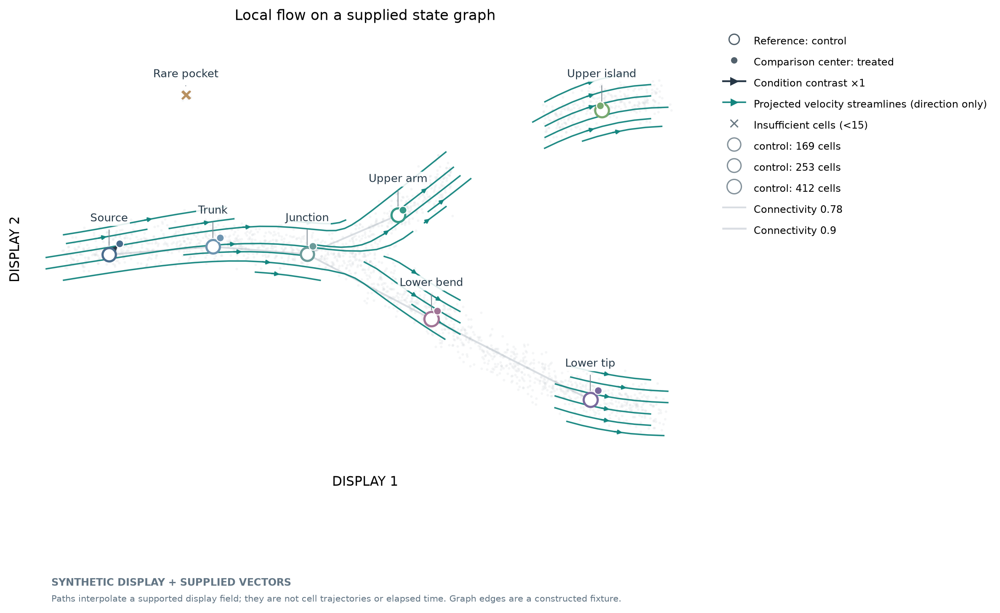
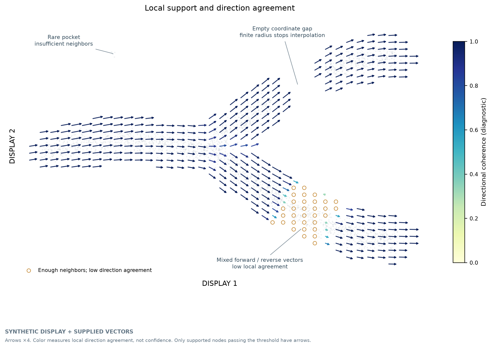
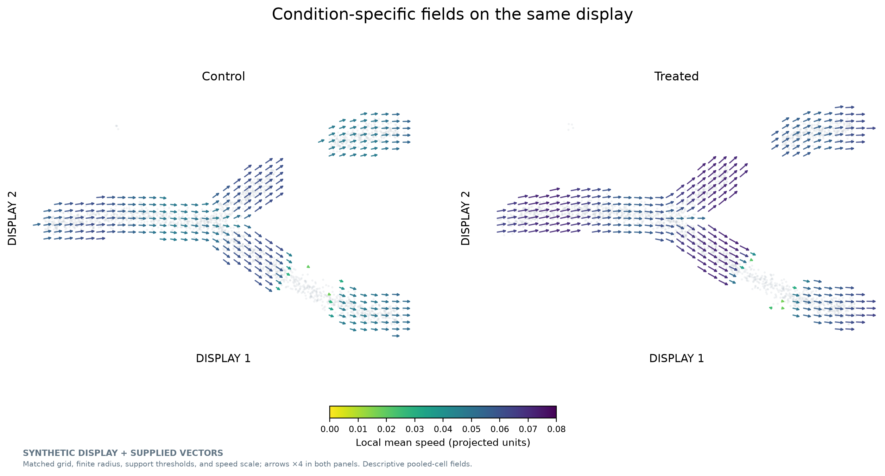

# Supported local velocity fields

`scgeo.pl.velocity_field` summarizes compatible projected cell vectors on a
regular display grid. Draw arrows to inspect local direction and magnitude,
or streamlines to see the structure of the supported interpolated field. The
same field can be placed beneath state centers and condition shifts with
`scgeo.pl.paga_shift_map`.

[Plotting guide](PLOTTING.md) · [State-graph guide](PAGA_SHIFT_MAP.md) ·
[Plotting API](api/pl.md) · [Interpretation](RESULT_INTERPRETATION.md)

For an actual public dataset with supplied UMAP and fitted projected velocities,
see the [pancreas real-data example](REAL_DATA_PLOTTING.md#pancreas-render-the-upstream-projected-velocity).
It reuses the upstream vectors and exports the support diagnostics for all
2,531 cells. The synthetic examples below remain useful for inspecting known
gaps, cancellation, and matched condition displays.

## See the result



**This example is fully synthetic.** It constructs curved cell corridors, a
symmetric graph fixture, and vectors from analytic curve tangents. No UMAP
embedding, PAGA graph, RNA-velocity model, or biological trajectory was fitted.
The paths show interpolation in those constructed display coordinates.

The fixture includes an empty gap in the upper arm, mixed forward and reverse
vectors in part of the lower arm, and a rare pocket below the neighbor-support
threshold. A third condition has overlapping coordinates and deliberately
different vectors; it is excluded from the requested control/treated fields.

## Run the offline gallery

These are **unreleased development features**. Use the source checkout
containing this guide and its example:

```bash
python -m pip install -e .
python -m pip check
git rev-parse HEAD
python examples/velocity_field_gallery.py --output-dir results/velocity_fields
```

The example needs only ScGeo's core dependencies and downloads nothing. It
writes three figures, containing four views, as PNG, SVG, and PDF with source
tables and JSON metadata. For quick PNG previews:

```bash
python examples/velocity_field_gallery.py \
    --output-dir results/velocity_fields --formats png
```

| Output stem | What it demonstrates |
|---|---|
| `velocity_paga_stream` | A local streamline field beneath the supplied state graph and observed condition centers |
| `velocity_field_grid` | Local arrows, direction-agreement coloring, an empty support gap, and a sparse pocket |
| `velocity_condition_comparison` | Control and treated fields with the same grid, support settings, color scale, and arrow multiplier |

Record the checkout commit alongside an export. Each gallery result also
records its seed, coordinate construction, vector construction, condition
counts, graph provenance, and deliberately injected diagnostic regions.

## Start with compatible projected vectors

For a real analysis, both the embedding and its compatible projected vectors
must already exist. For example, `basis="umap"` reads `adata.obsm["X_umap"]`
and the matching overlay reads `adata.obsm["velocity_umap"]`:

```python
import scgeo as sg

result = sg.pl.velocity_field(
    adata,
    basis="umap",
    velocity_basis="umap",
    mode="grid",
    condition_key="condition",
    groups=["control", "treated"],
    background="selected",
    grid_size=35,
    n_neighbors=40,
    radius=0.45,
    min_neighbors=12,
    min_coherence=0.30,
    return_result=True,
    show=False,
)
```

Here `radius=0.45` is only an example in the chosen embedding's coordinate
units. Choose it for the scale and sampling density of your own display.

`velocity_basis=None`, the default, inherits the display basis. The velocity
array must match the embedding's full shape and coordinate system; the first
two coordinates are drawn. A PCA-space vector cannot be placed directly on a
UMAP display. Renaming an unrelated array does not create a valid projection.
The plotting function does not fit a velocity model, compute UMAP, or project
high-dimensional vectors into a nonlinear embedding.

The standalone estimator uses rows with finite display coordinates and finite
projected vectors jointly. Its full source table preserves excluded rows and
their eligibility flags so missing vectors remain inspectable.

The gallery therefore uses `basis="display"` and `velocity_display`. Those
names identify constructed coordinates and supplied vectors without implying
an embedding or velocity analysis that was never performed.

## Understand support before interpreting a path

The local field uses distance-weighted projected vectors within a **finite
radius**, with at most `n_neighbors` nearest eligible cells contributing to a
grid node. Unsupported nodes remain masked. Increasing the density of the
drawn grid cannot create missing observations.

| Parameter | Role |
|---|---|
| `grid_size` | Resolution per axis, given as an integer or `(nx, ny)` |
| `grid_extent` | Explicit `(xmin, xmax, ymin, ymax)` region in which that grid is constructed |
| `radius` | Maximum coordinate-space distance from a node to an eligible source cell |
| `n_neighbors` | Cap on contributing nearby cells at a node |
| `min_neighbors` | Minimum count of eligible contributing cells needed for support |
| `min_coherence` | Minimum local direction agreement required to display the node |

When `radius=None`, the estimator derives a radius from the full eligible
source data. That can be useful for exploring a single field. Use an explicit
shared radius when comparing panels so a density change does not silently
change the smoothing distance.

`xlim` and `ylim` set the visible crop; they do not define the computational
grid or change its source population. Set `grid_extent` explicitly when grid
locations need to match across groups.

A field is constructed in coordinate space. State labels and supplied graph
edges do not act as interpolation barriers. Review the radius around nearby
but distinct populations, and inspect the exported support counts and masks.

### Empty regions, rare states, and cancellation



The diagnostic view makes three different reasons for an absent field visible:

- The **upper gap** contains no source cells. The finite radius prevents the
  local field from spanning its unsupported middle.
- The **rare pocket** has too few eligible neighbors. Its observed cells remain
  visible, while no local field is invented around them.
- The **lower patch** contains vectors pointing in opposing directions. Nodes
  with enough neighbors can still fail the direction-agreement threshold. The
  gallery marks those nodes with hollow amber circles taken directly from the
  returned grid table.

A blank region does not by itself establish a stationary population. Read its
support reason: insufficient observations, conflicting directions, a zero
local vector, and undefined directional agreement are different cases.

## Treat coherence as a diagnostic

`color_by="coherence"` colors local direction agreement on a `[0, 1]` scale.
Opposing directions lower that agreement; similarly oriented vectors raise
it. It is the norm of the weighted mean vector divided by the weighted mean
individual vector norm. **Coherence is not confidence, a p-value, an uncertainty
interval, or a measure of biological reproducibility.** It describes the supplied projected
vectors and the chosen local neighborhood.

The field pools eligible cells. A neighbor count is a count of cells, not a
count of independent biological samples. Although the synthetic fixture
records four independent sample identities per condition, the plotted field
does not use those identities for sample-level inference.

For magnitude coloring, `color_by="speed"` means the norm of the local weighted
mean vector. Opposing vectors can produce a small mean even when individual
vectors have large magnitudes. The source grid also records `mean_speed`, the
weighted mean of individual vector norms, so cancellation remains inspectable.
Neither quantity is a calibrated biological speed unless the upstream model
and coordinate system justify that interpretation.

## Choose arrows or streamlines deliberately

In `mode="grid"`, arrows begin at supported grid nodes. A numeric `scale`
multiplies the local vector in display-coordinate units. `scale="auto"`
chooses a readable display multiplier from supported field magnitudes and
grid spacing; the resolved multiplier is recorded in metadata.

Automatic scaling is convenient for one view. For comparisons of magnitudes,
use the **same numeric multiplier**, compatible coordinates, common support
parameters, and a common color normalization.

In `mode="stream"`, paths follow the interpolated direction field through its
supported region. `stream_density` and `stream_linewidth` control their visual
density and width. The paths are not tracked cells, lineage assignments,
elapsed time, or proof that one state develops into another. The grid-arrow
display multiplier does not calibrate streamline time.

## Add a local field to a state graph

```python
result = sg.pl.paga_shift_map(
    adata,
    node_key="cell_type",
    condition_key="condition",
    group0="control",
    group1="treated",
    basis="umap",
    graph_node_order=graph_order,
    show_velocity=True,
    velocity_mode="stream",
    velocity_color="#14857F",
    velocity_options={
        "grid_size": 35,
        "n_neighbors": 40,
        "radius": 0.45,
        "min_neighbors": 12,
        "min_coherence": 0.30,
        "stream_density": 1.2,
        "stream_linewidth": 1.1,
    },
    background="contrast",
    return_result=True,
    show=False,
)
```

The default `velocity_mode="state"` retains the state-level velocity overlay.
Choose `"grid"` for local arrows or `"stream"` for interpolated paths. Local
fields use only the selected `group0` and `group1`; a third displayed condition
does not enter the field estimator.

The existing `velocity_scale` applies to the state-level overlay. For a local
grid, set `velocity_options={"scale": ...}`; its default is `"auto"`. A
streamline display has no elapsed-time interpretation.

The local field uses its own uniform `velocity_color`. Stored scalar coloring
of state nodes can remain enabled at the same time. The graph still needs an
explicit row/column label mapping, and condition-shift arrows still connect
cell-level display centers. See the [state-graph guide](PAGA_SHIFT_MAP.md) for
those separate geometric and quantitative meanings.

## Compare conditions on a common display



For a fair visual comparison, hold these choices fixed:

- Compatible coordinates and identical `grid_extent` and `grid_size`.
- The same `radius`, `n_neighbors`, `min_neighbors`, and `min_coherence`.
- A shared `Normalize` object and the same numeric grid-arrow `scale`.
- Common visible limits and aspect ratio.

```python
import matplotlib.pyplot as plt
from matplotlib.colors import Normalize

fig, axes = plt.subplots(1, 2, figsize=(12, 5), sharex=True, sharey=True)
# Allocate the final axes geometry before plotting.
fig.subplots_adjust(left=.06, right=.97, bottom=.15, top=.90, wspace=.18)
common = dict(
    basis="umap", condition_key="condition", mode="grid",
    grid_extent=(-6, 5, -4, 4), grid_size=35,
    radius=.45, n_neighbors=40, min_neighbors=12, min_coherence=.30,
    xlim=(-6, 5), ylim=(-4, 4), aspect="equal",
    color_by="speed", norm=Normalize(0, .08), scale=4.0,
    background="selected", legend=False, show_colorbar=False,
    return_result=True, show=False,
)
control = sg.pl.velocity_field(adata, groups=["control"], ax=axes[0], **common)
treated = sg.pl.velocity_field(adata, groups=["treated"], ax=axes[1], **common)
```

The limits and magnitude values above are illustrative; choose values suitable
for the actual coordinates and supplied vectors. A shared speed scale does
not make unrelated embeddings quantitatively comparable. The runnable gallery
also demonstrates a dedicated shared colorbar and exports both panels' source
tables in one `PlotResult`.

`condition_key` and `groups` select the field's source population.
`background="selected"` displays that population; `background="all"` can show
additional context without changing the field source. `background_key` and
`palette` optionally color the background by an observation category.

`max_points`, `random_state`, and `required_indices` control displayed
background sampling only. They do not reduce the cells used to estimate the
field. The full source-cell table records eligibility and which cells were
actually displayed.

## Export the field and its provenance

```python
result.save(
    "results/velocity_fields/my_field",
    formats=("png", "svg", "pdf"),
    dpi=300,
    include_data=True,
    include_metadata=True,
)
```

Use `return_result=True` to obtain a `PlotResult` with named axes, artists,
source tables, warnings, and metadata. A standalone result names its main axis
`"field"`; a numeric colorbar is included when requested.

The grid table retains every computational node, including masked ones. Its
columns include coordinates, mean vectors, speed, mean individual speed,
coherence, neighbor counts, radius, support flags, and the reason a node was
not displayed. The cell table preserves the full input population and source
eligibility. Grid-vector endpoints and actual rendered streamline paths are
exported for the selected mode.

The gallery additionally exports `fixture_observations`, preserving every
generated cell's sample identity, state, condition, and injected-region flags.

PAGA local-field results use the prefixed keys `velocity_grid`,
`velocity_cells`, `velocity_vectors`, and `velocity_paths` as applicable, with
field configuration in `local_velocity` metadata. These accompany the graph,
condition-center, and other existing plot sources.

Keep the source tables and metadata with a figure so its selected conditions,
support choices, display multiplier, and coordinate provenance remain clear.
For a multi-panel figure, preserve all panels' source tables, as the runnable
comparison example does. See the [citation guide](CITING.md) for software and
checkout attribution.
